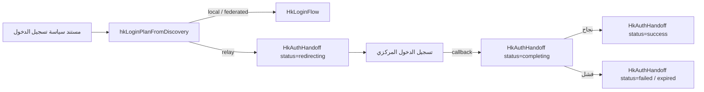

# أوضاع تسجيل الدخول

يوفر Hikari تدفق تسجيل دخول واحدًا (`HkLoginFlow`) وثلاثة عناصر حوله تتيح لكل واجهة أمامية من Celestia تركيب واجهة تسجيل الدخول نفسها من مستند سياسة تسجيل الدخول الخاص بالخادم: محوّل اكتشاف، وشاشة تمرير، وصوفوف قنوات قادرة على أن تكون روابط حقيقية.



## الأوضاع الثلاثة

| الوضع | نموذج كلمة المرور | صفوف مقدّمي الخدمة | ما يركّبه المضيف |
| --- | --- | --- | --- |
| `local` | قناة بيانات اعتماد واحدة | كل مدخل من نوع غير `oauth` (حاليًا `passkey`، `custom`) | `HkLoginFlow` بقناة واحدة، دون مجموعة مقاطع |
| `federated` مع `password: true` | قناة بيانات اعتماد واحدة | كل الطرق (`oauth`، `passkey`، `custom`) أسفل النموذج | `HkLoginFlow` بقناة واحدة |
| `federated` مع `password: false` | لا يوجد | كل طريقة تصبح قناة `sso` مستقلة | `HkLoginFlow` بقناة لكل طريقة |
| `relay` | لا يوجد | لا يوجد | **بدون `HkLoginFlow`** — يحوّل `HkAuthHandoff` إلى تسجيل الدخول المركزي |

## محوّل الاكتشاف

`loginDiscovery.ts` مجموعة دوال خالصة: لا تفاعلية، لا نقطة نهاية، لا بناء لعناوين URL. تطابق الأنواع مستند الشبكة حقلًا بحقل (`version`، `mode`، `password`، `methods[]`، `relay`).

```tsx
import {
  hkLoginPlanFromDiscovery, hkRelayEntryHref,
  HkAuthHandoff, HkLoginFlow,
} from "@celestia-island/hikari/vue";

const plan = hkLoginPlanFromDiscovery(policy, {
  credentialsKey: "cloud",          // الافتراضي "cloud"
  credentialsLabel: "Celestia",     // تسمية اختيارية للمقطع
  divider: "طرق أخرى لتسجيل الدخول", // اختياري؛ يُحذف إذا لم يُمرَّر
});
const channel = ref(plan.defaultChannel ?? "");
```

| التصدير | النتيجة |
| --- | --- |
| `hkLoginPlanFromDiscovery(doc, copy?)` | `{ mode, channels, defaultChannel }`؛ في وضع relay تكون `channels` هي `[]` و`defaultChannel` هي `null` |
| `hkRelayEntryHref(doc, returnTo?)` | `null` خارج وضع relay؛ وإلا فعنوان URL للدخول، مع إضافة عنوان العودة فقط إذا كان مسارًا من الأصل نفسه |
| `hkIsSameOriginPath(raw)` | `true` لـ `/x`؛ `false` لـ `//host` و`/` وعناوين URL النسبية أو المطلقة، ولكل مسار يحتوي شرطة مائلة عكسية أو محرف تحكم أو محرف تنسيق يعيد تشكيل العرض (القاعدة نفسها التي يطبّقها kirino على أهداف التنقل) |

تُتجاهل أنواع الطرق غير المعروفة والطرق التي يكون فيها `id` فارغًا — فالمحوّل لا يرمي استثناءً أبدًا بسبب مستند لا يفهمه.

## شاشة التمرير

`HkAuthHandoff` هي شاشة تسجيل الدخول التي ليست نموذجًا: شاشة وضع relay الافتتاحية، وتبادل رد الاتصال، والحالات النهائية. مبنية على `HkAuthScreen` وتستخدم قواعد بطاقة المصادقة (الشعار، العنوان، الوصف).

```tsx
<HkAuthHandoff
  status={state}                 // "redirecting" | "completing" | "success" | "failed" | "expired"
  logoSrc="/logo.svg"
  href={entryHref ?? undefined}  // redirecting: هدف التنقل
  delayMs={600}
  onRedirect={(href) => allow(href)}  // أرجع false للإلغاء
  onRetry={() => restart()}
  onBack={() => router.push("/login")}
/>
```

| الخاصية | الافتراضي | الأثر |
| --- | --- | --- |
| `status` | مطلوبة | مؤشر دوّار ومنطقة حيّة مهذّبة لـ `redirecting` / `completing`؛ و`role="alert"` لـ `failed` / `expired` |
| `title` / `description` | `undefined` | تتجاوز نص الحالة من `hikari::authHandoff.*`؛ لا وصف افتراضيًا |
| `logoSrc` | `undefined` | بدون شعار |
| `href` | `undefined` | عند تمريره يتنقل المكوّن بعد `delayMs`؛ وإلا يتنقل المضيف عند `redirect` |
| `delayMs` | `0` | مدة عرض الشاشة الافتتاحية قبل التنقل |
| `actions` | `["back"]` لـ `failed` / `expired`، و`[]` لغيرهما | أزرار مدمجة؛ ويستبدلها مصرف `actions` |

الأحداث: `redirect(href)`، `retry()`، `back()`. المصارف: `header`، `footer` (تُمرَّر إلى `HkAuthScreen`)، `actions`.

## صفوف الروابط

يمكن لـ `HkAuthChannelListEntry` — ولـ `HkLoginSsoChannel` التي تمرّرها — أن تحمل `href`. عندها يُعرض الصف كـ `<a href>` حقيقية: النقر بالزر الأوسط وCtrl-نقر يعملان وترى برامج الزحف الهدف. لا يزال `select(key)` (أو `sso-click`) يُطلق أولًا ولا يُمنع التنقل أبدًا. الرابط المعطّل لا يحمل `href`، ويُتخطّى مثل الزر المعطّل، ويحمل `aria-disabled="true"`. بدون `href` يبقى الصف `<button type="button">` كما كان من قبل.

## مسؤوليات المضيف

- تحقّق من مستند سياسة تسجيل الدخول على الخادم؛ فـ Hikari يثق بما يُمرَّر إليه.
- في وضع relay لا تركّب `HkLoginFlow` — تركّب `HkAuthHandoff`.
- لا تمرّر سوى مسارات من الأصل نفسه كعنوان عودة؛ استخدم `hkIsSameOriginPath` أو قائمة السماح الخاصة بك.
- يجب أن تكون قيم `href` للصفوف مسارات من نفس الأصل أيضًا (يُتحقق من المستند على الخادم)؛ ولا يفحصها hikari.

## الصف المضمَّن لمزوّد الهوية المركزي

لا يملك مزوّد الهوية المركزي (`provider: "erp"` في مستند سياسة تسجيل الدخول) اسمًا أو أيقونة خاصة به على مستوى البروتوكول، فكان كل مضيف يبتكر ما يخصّه: إمّا `erp` عاريةً في الصف، أو «Celestia ID» مكتوبة يدويًا دون أيقونة. يوفّر hikari الآن هذين الافتراضيين معًا:

- **الاسم** — `hkCentralAuthName()`، أو العبارة التي كنت ستكتبها يدويًا `t(HK_CENTRAL_AUTH_NAME_KEY, HK_CENTRAL_AUTH_NAME_EN)` (المفتاح `hikari::loginFlow.providerCelestiaAuth` متوفّر في اللغات الإحدى عشرة كلها). فضّل `hkCentralAuthName()`: فهي تقرأ سياق اللغة الخاص بـ hikari، فيبقى الاسم مترجمًا حتى في مضيف لا يدمج مفاتيح `hikari::` في كتالوجه. استدعها داخل دالة العرض أو داخل `computed`، لا على مستوى الوحدة.
- **الأيقونة** — `hkCentralAuthMarkSrc`، وهي data URI بصيغة WebP بحجم 64×64 مضمّنة. اعرضها بحجم 16×16؛ فالمصدر يحمل الهامش الذي يجعلها بالحجم البصري نفسه للرموز المجاورة.

تبقى إعدادات المشغّل هي الأولى دائمًا: لا يُستبدل `label` أو `icon` للمزوّد إذا حُدِّدا في إعدادات النشر. لا يُستخدم الاسم المضمَّن إلا حين ينحدر التسمية إلى المعرّف نفسه (`hkProviderLabelIsId`)، ولا تُستخدم الأيقونة المضمَّنة إلا حين لا يرسل الخادم أيقونة. أمّا النشر الذي لا يضبط هذا المزوّد فلا يتغيّر فيه شيء — فالافتراضي عند الاستضافة الذاتية يظل اسم المستخدم وكلمة المرور المحليين.

وثمّة قاعدة عرض إضافية نابعة من تسليم الجلسة (hand-off): قناة إعادة التوجيه (sso) لا تملك عادةً خطوة ثانية، لذا فإن تمرير `step="verify"` فيها يعرض متن الحساب كإجراء احتياطي. أمّا إذا وصلت إلى المضيف قائمة عوامل التحقق عبر تسليم OAuth ومرّرها في `verifyFactors`، فإن قناة sso تعرض خطوة التحقق شأنها شأن قناة بيانات الاعتماد — وإلا وقع النشر الذي يعتمد «SSO فقط» مع MFA في طريق مسدود.
