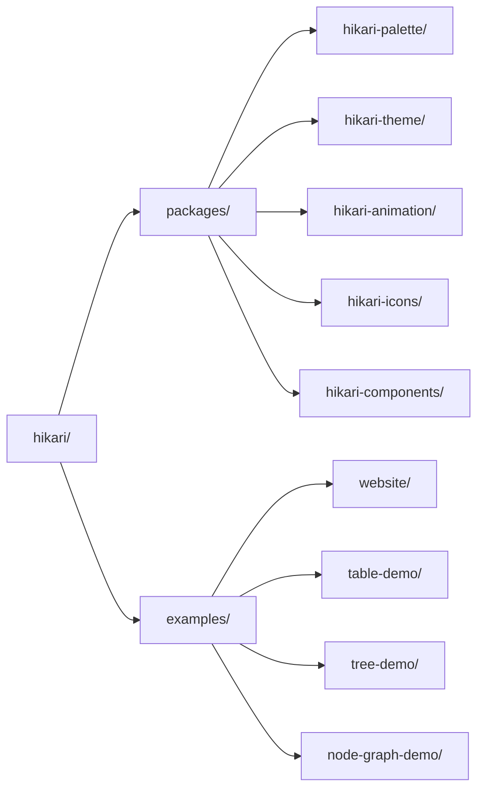

# مكتبة هيكاري لواجهة المستخدم

> مكتبة واجهة مستخدم للجيل التالي مبنية على Tairitsu + Grass + Axum
>
> **التموضع**: نظام تصميم واحد، بيئتا تشغيل — Vue 3 و Rust/WASM

## ما هو هيكاري؟

هيكاري مكتبة واجهة مستخدم للجيل التالي. نظام تصميم واحد يُسلَّم لبيئتَي تشغيل من الدرجة الأولى: حُزم `hikari-*` لـ Rust/WASM (على إطار عمل Tairitsu) و`@celestia-island/hikari` لـ Vue 3. تعتمد المكتبة تصميماً معيارياً، يوفر مكتبة مكونات كاملة ونظام سمات ونظام رسوم متحركة؛ وتتطور هذه النواة التصميمية نفسها أيضاً نحو واجهات تطبيقات مستقلة.

## الميزات الأساسية

### اللوحة والسمات
- **أكثر من 660 لون منقّى**: مجموعات تاريخية وحديثة، ثوابت آمنة للنوع
- **نظام السمات**: سمات فاتحة/داكنة مدمجة وإعدادات مسبقة مخصصة
- **أمان الأنواع**: فحص قيم الألوان في وقت الترجمة

### مكتبة مكونات غنية
- **المكونات الأساسية**: زر، حقل إدخال، بطاقة، شارة
- **مكونات التغذية الراجعة**: تنبيه، إشعار، تلميح، بقعة ضوئية
- **مكونات التنقل**: قائمة، تبويبات، مسار التنقل
- **مكونات البيانات**: جدول، شجرة، ترقيم الصفحات
- **مكونات التخطيط**: تخطيط، رأس، جانب، محتوى، تذييل

### نظام رسوم متحركة قوي
- **رسوم متحركة تصريحية**: API سلس يشبه CSS
- **قيم ديناميكية**: قيم رسوم متحركة محسوبة أثناء التشغيل
- **دوال التسهيل**: أكثر من 30 دالة تسهيل
- **رسوم متحركة مسبقة**: تلاشي، انزلاق، تكبير، إلخ

### ميزات متقدمة
- **العرض من جانب الخادم**: دعم SSR كامل
- **أمان الأنواع**: الاستفادة الكاملة من نظام أنواع Rust
- **التصميم المستجيب**: أدوات تخطيط مستجيبة مدمجة
- **نظام البناء**: تجميع SCSS آلي وتوليد الأصول

## البدء السريع

### تثبيت التبعيات

أضف إلى `Cargo.toml`:

```toml
[dependencies]
hikari-components = "0.1"
hikari-palette = "0.1"
hikari-theme = "0.1"
tairitsu = "0.5"
```

### الاستخدام الأساسي

```rust
use hikari_components::{ThemeProvider, Button};
use hikari_theme::ThemeProvider;

#[component]
fn App() -> Element {
    rsx! {
        ThemeProvider { initial_palette: "hikari" } {
            div { class: "hi-flex hi-flex-col hi-gap-4" {
                Button { label: "اضغط هنا" }
                Button { label: "زر رئيسي", variant: "primary" }
                Button { label: "زر ثانوي", variant: "secondary" }
            }
        }
    }
}
```

### البناء والتشغيل

```bash
# وضع التطوير
cargo run

# البناء
cargo build --release

# بناء WASM
trunk build --release
```

## فلسفة التصميم

### نظام تصميم واحد، بيئتا تشغيل
- تنفيذا Vue 3 و Rust/WASM تتشاركان المكونات والرموز التصميمية نفسها
- نواة SCSS مشتركة تضمن تطابقاً بصرياً كاملاً في الجانبين

### الدقة والوضوح
- أسطح مسطحة وتسلسل هرمي واضح للمعلومات
- تباين عالٍ للقراءة
- لمسات وحركات متحركة منضبطة وذات غرض

### مصمم للذهاب إلى أبعد من ذلك
- العرض من جانب الخادم متاح اليوم في جانب Rust
- النواة التصميمية نفسها معدة للتوسع نحو واجهات التطبيقات المستقلة

## هيكل المشروع



## التوثيق

- [المكونات](./components/) - دليل استخدام مكونات واجهة المستخدم
- [النظام](./system/) - بنية النظام الأساسية
- [مرجع API](https://docs.rs/hikari-components) - توثيق Rust API

## أمثلة

### تبديل السمات

```rust
use hikari_theme::ThemeProvider;

fn App() -> Element {
    let mut theme = use_signal(|| "hikari".to_string());

    rsx! {
        ThemeProvider { initial_palette: "{theme}" } {
            button {
                onclick: move |_| {
                    theme.set(if *theme() == "hikari" {
                        "tairitsu".to_string()
                    } else {
                        "hikari".to_string()
                    });
                },
                "تبديل السمة"
            }
        }
    }
}
```

### استخدام الرسوم المتحركة

```rust
use hikari_animation::{AnimationBuilder, AnimationContext};
use hikari_animation::style::CssProperty;

// رسوم متحركة ثابتة
AnimationBuilder::new(&elements)
    .add_style("button", CssProperty::Opacity, "0.8")
    .apply_with_transition("300ms", "ease-in-out");

// رسوم متحركة ديناميكية (متابعة الفأرة)
AnimationBuilder::new(&elements)
    .add_style_dynamic("button", CssProperty::Transform, |ctx| {
        let x = ctx.mouse_x();
        let y = ctx.mouse_y();
        format!("translate({}px, {}px)", x, y)
    })
    .apply_with_transition("150ms", "ease-out");
```

## المساهمة

المساهمات مرحب بها! يرجى قراءة [CONTRIBUTING.md](../../en/guides/CONTRIBUTING.md) للتفاصيل.

## الترخيص

[Synthetic Source License (SySL), Version 1.0](../../../LICENSE)

## شكر وتقدير

- **Tairitsu** - إطار عمل Rust قوي لواجهة المستخدم
- [Grass](https://github.com/kaj/kaj) - مترجم SCSS نقي بلغة Rust
- [Element Plus](https://element-plus.org/) - مرجع تصميم مكتبة مكونات ممتازة
- [Material UI](https://mui.com/) - إلهام تصميم واجهة مستخدم حديثة

---

**هيكاري** - نظام تصميم واحد، لكل بيئات التشغيل
