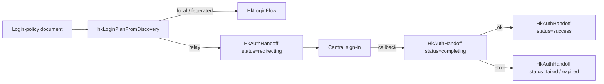

# Login Modes

Hikari ships one sign-in flow (`HkLoginFlow`) and three things around it that let every Celestia front end mount the same login UI from the server's login-policy document: a discovery adapter, a hand-off screen, and link-capable channel rows.



## The three modes

| Mode | Password form | Provider rows | What the host mounts |
| --- | --- | --- | --- |
| `local` | One credentials channel | Every non-`oauth` kind of entrance (today `passkey`, `custom`) | `HkLoginFlow` with a single channel — no segment group |
| `federated`, `password: true` | One credentials channel | Every method (`oauth`, `passkey`, `custom`) under the form | `HkLoginFlow` with a single channel |
| `federated`, `password: false` | None | Every method becomes its own `sso` channel | `HkLoginFlow` with one channel per method |
| `relay` | None | None | **No `HkLoginFlow`** — `HkAuthHandoff` redirects to the central sign-in |

## Discovery adapter

`loginDiscovery.ts` is a set of pure functions: no reactivity, no endpoint, no URL building. The types mirror the wire document (`version`, `mode`, `password`, `methods[]`, `relay`) field for field.

```tsx
import {
  hkLoginPlanFromDiscovery, hkRelayEntryHref,
  HkAuthHandoff, HkLoginFlow,
} from "@celestia-island/hikari/vue";

const plan = hkLoginPlanFromDiscovery(policy, {
  credentialsKey: "cloud",          // default "cloud"
  credentialsLabel: "Celestia",     // optional segment label
  divider: "Other ways to sign in", // optional; omitted when not given
});
const channel = ref(plan.defaultChannel ?? "");
```

| Export | Result |
| --- | --- |
| `hkLoginPlanFromDiscovery(doc, copy?)` | `{ mode, channels, defaultChannel }`; `channels` is `[]` and `defaultChannel` is `null` in relay mode |
| `hkRelayEntryHref(doc, returnTo?)` | `null` outside relay mode; otherwise the entry URL, with the return address appended only when it is a same-origin path |
| `hkIsSameOriginPath(raw)` | `true` for `/x`; `false` for `//host`, `/`, relative or absolute URLs, and any path with a backslash, a control character or a display-reshaping format character (the rule kirino applies to navigation targets) |

Unknown method kinds and methods with an empty `id` are ignored — the adapter never throws on a document it does not understand.

## Hand-off screen

`HkAuthHandoff` is the sign-in screen that is not a form: the relay splash, the callback exchange, and the terminal states. It is built on `HkAuthScreen` and uses the auth card grammar (logo, title, description).

```tsx
<HkAuthHandoff
  status={state}                 // "redirecting" | "completing" | "success" | "failed" | "expired"
  logoSrc="/logo.svg"
  href={entryHref ?? undefined}  // redirecting: the navigation target
  delayMs={600}
  onRedirect={(href) => allow(href)}  // return false to cancel
  onRetry={() => restart()}
  onBack={() => router.push("/login")}
/>
```

| Prop | Default | Effect |
| --- | --- | --- |
| `status` | required | Spinner and a polite live region for `redirecting` / `completing`; `role="alert"` for `failed` / `expired` |
| `title` / `description` | `undefined` | Override the status copy from `hikari::authHandoff.*`; no description by default |
| `logoSrc` | `undefined` | No logo |
| `href` | `undefined` | With it the component navigates after `delayMs`; without it the host navigates on `redirect` |
| `delayMs` | `0` | How long the splash shows before navigating |
| `actions` | `["back"]` for `failed` / `expired`, `[]` otherwise | Built-in buttons; the `actions` slot replaces them |

Events: `redirect(href)`, `retry()`, `back()`. Slots: `header`, `footer` (forwarded to `HkAuthScreen`), `actions`.

## Link rows

An `HkAuthChannelListEntry` — and an `HkLoginSsoChannel` that forwards it — may carry `href`. The row then renders as a real `<a href>`: middle-click and ctrl-click work and crawlers see the target. `select(key)` (or `sso-click`) still fires first and navigation is never prevented. A disabled link has no `href`, is skipped like a disabled button and carries `aria-disabled="true"`. Without `href` the row stays a `<button type="button">`, as before.

## Host responsibilities

- Validate the login-policy document on the server; hikari trusts what it is handed.
- In relay mode, do not mount `HkLoginFlow` — mount `HkAuthHandoff`.
- Only pass same-origin paths as return addresses; use `hkIsSameOriginPath` or your own allow-list.
- Row `href` values are same-origin paths too (the document is validated on the server); hikari does not check them.
