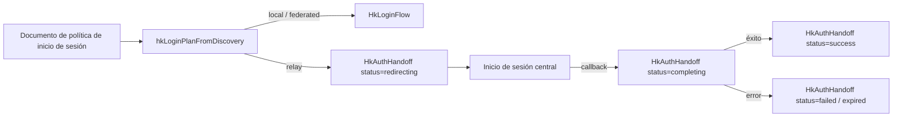

# Modos de inicio de sesión

Hikari ofrece un único flujo de inicio de sesión (`HkLoginFlow`) y, a su alrededor, tres piezas que permiten a cada front-end de Celestia montar la misma interfaz de inicio de sesión a partir del documento de política de inicio de sesión del servidor: un adaptador de descubrimiento, una pantalla de traspaso y filas de canal capaces de ser enlaces reales.



## Los tres modos

| Modo | Formulario de contraseña | Filas de proveedor | Lo que monta el anfitrión |
| --- | --- | --- | --- |
| `local` | Un canal de credenciales | Toda entrada de un tipo distinto de `oauth` (hoy `passkey`, `custom`) | `HkLoginFlow` con un solo canal, sin grupo de segmentos |
| `federated`, `password: true` | Un canal de credenciales | Todos los métodos (`oauth`, `passkey`, `custom`) bajo el formulario | `HkLoginFlow` con un solo canal |
| `federated`, `password: false` | Ninguno | Cada método se convierte en su propio canal `sso` | `HkLoginFlow` con un canal por método |
| `relay` | Ninguno | Ninguna | **Sin `HkLoginFlow`** — `HkAuthHandoff` redirige al inicio de sesión central |

## Adaptador de descubrimiento

`loginDiscovery.ts` es un conjunto de funciones puras: sin reactividad, sin endpoint, sin construcción de URL. Los tipos coinciden campo a campo con el documento de red (`version`, `mode`, `password`, `methods[]`, `relay`).

```tsx
import {
  hkLoginPlanFromDiscovery, hkRelayEntryHref,
  HkAuthHandoff, HkLoginFlow,
} from "@celestia-island/hikari/vue";

const plan = hkLoginPlanFromDiscovery(policy, {
  credentialsKey: "cloud",          // por defecto "cloud"
  credentialsLabel: "Celestia",     // etiqueta de segmento opcional
  divider: "Otras formas de iniciar sesión", // opcional; se omite si no se proporciona
});
const channel = ref(plan.defaultChannel ?? "");
```

| Exportación | Resultado |
| --- | --- |
| `hkLoginPlanFromDiscovery(doc, copy?)` | `{ mode, channels, defaultChannel }`; `channels` es `[]` y `defaultChannel` es `null` en modo relay |
| `hkRelayEntryHref(doc, returnTo?)` | `null` fuera del modo relay; en caso contrario, la URL de entrada, añadiendo la dirección de retorno solo si es una ruta del mismo origen |
| `hkIsSameOriginPath(raw)` | `true` para `/x`; `false` para `//host`, `/`, URL relativas o absolutas, y para toda ruta con barra invertida, carácter de control o carácter de formato que altera la visualización (la misma regla que kirino aplica a los destinos de navegación) |

Los tipos de método desconocidos y los métodos con un `id` vacío se ignoran — el adaptador nunca lanza una excepción ante un documento que no entiende.

## Pantalla de traspaso

`HkAuthHandoff` es la pantalla de inicio de sesión que no es un formulario: el intersticial del modo relay, el intercambio del callback y los estados terminales. Se construye sobre `HkAuthScreen` y usa la gramática de la tarjeta de autenticación (logotipo, título, descripción).

```tsx
<HkAuthHandoff
  status={state}                 // "redirecting" | "completing" | "success" | "failed" | "expired"
  logoSrc="/logo.svg"
  href={entryHref ?? undefined}  // redirecting: el destino de navegación
  delayMs={600}
  onRedirect={(href) => allow(href)}  // devuelve false para cancelar
  onRetry={() => restart()}
  onBack={() => router.push("/login")}
/>
```

| Propiedad | Por defecto | Efecto |
| --- | --- | --- |
| `status` | obligatoria | Spinner y región live cortés para `redirecting` / `completing`; `role="alert"` para `failed` / `expired` |
| `title` / `description` | `undefined` | Sustituye el texto de estado de `hikari::authHandoff.*`; sin descripción por defecto |
| `logoSrc` | `undefined` | Sin logotipo |
| `href` | `undefined` | Si se proporciona, el componente navega tras `delayMs`; si no, el anfitrión navega en `redirect` |
| `delayMs` | `0` | Cuánto se muestra el intersticial antes de navegar |
| `actions` | `["back"]` para `failed` / `expired`, `[]` en los demás | Botones integrados; el slot `actions` los sustituye |

Eventos: `redirect(href)`, `retry()`, `back()`. Slots: `header`, `footer` (reenviados a `HkAuthScreen`), `actions`.

## Filas enlace

Una `HkAuthChannelListEntry` — y una `HkLoginSsoChannel` que la reenvía — puede llevar un `href`. La fila se representa entonces como un `<a href>` real: el clic central y el Ctrl-clic funcionan y los rastreadores ven el destino. `select(key)` (o `sso-click`) se sigue emitiendo primero y la navegación nunca se impide. Un enlace deshabilitado no tiene `href`, se salta como un botón deshabilitado y lleva `aria-disabled="true"`. Sin `href`, la fila sigue siendo un `<button type="button">`, como antes.

## Responsabilidades del anfitrión

- Validar el documento de política de inicio de sesión en el servidor; hikari confía en lo que recibe.
- En modo relay, no montar `HkLoginFlow` — montar `HkAuthHandoff`.
- Pasar solo rutas del mismo origen como dirección de retorno; usar `hkIsSameOriginPath` o su propia lista de permitidos.
- Los `href` de las filas también deben ser rutas del mismo origen (el documento se valida en el servidor); hikari no los comprueba.
