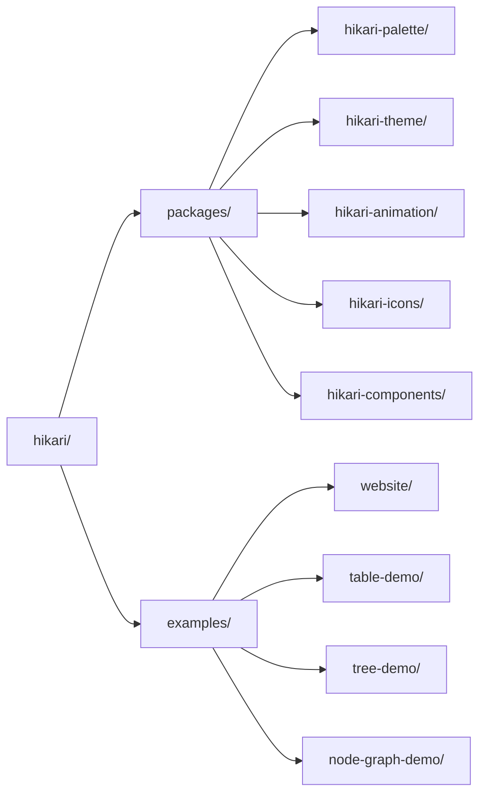

# Biblioteca UI Hikari

> Una biblioteca UI de nueva generación construida sobre Tairitsu + Grass + Axum
>
> **Posicionamiento**: un sistema de diseño, dos runtimes — Vue 3 y Rust/WASM

## ¿Qué es Hikari?

Hikari es una biblioteca UI de nueva generación. Un único sistema de diseño se entrega en dos runtimes de primer nivel: los crates `hikari-*` para Rust/WASM (sobre el framework Tairitsu) y `@celestia-island/hikari` para Vue 3. La biblioteca adopta un diseño modular, proporcionando una biblioteca completa de componentes, sistema de temas y sistema de animación; este mismo núcleo de diseño también avanza hacia las UI de aplicaciones independientes.

## Características Principales

### Paleta y Temas
- **660+ Colores Curados**: colecciones históricas y modernas, constantes con seguridad de tipos
- **Sistema de Temas**: temas claro/oscuro integrados y preajustes personalizados
- **Seguridad de Tipos**: Valores de color verificados en tiempo de compilación

### Rica Biblioteca de Componentes
- **Componentes Básicos**: Button, Input, Card, Badge
- **Componentes de Retroalimentación**: Alert, Toast, Tooltip, Spotlight
- **Componentes de Navegación**: Menu, Tabs, Breadcrumb
- **Componentes de Datos**: Table, Tree, Pagination
- **Componentes de Diseño**: Layout, Header, Aside, Content, Footer

### Potente Sistema de Animación
- **Animaciones Declarativas**: API fluida similar a CSS
- **Valores Dinámicos**: Valores de animación calculados en tiempo de ejecución
- **Funciones de Easing**: Más de 30 funciones de easing
- **Animaciones Predefinidas**: Fade, slide, scale, etc.

### Características Avanzadas
- **Renderizado del Lado del Servidor**: Soporte completo SSR
- **Seguridad de Tipos**: Uso completo del sistema de tipos de Rust
- **Diseño Responsivo**: Utilidades de diseño responsivo integradas
- **Sistema de Compilación**: Compilación SCSS automatizada y generación de assets

## Inicio Rápido

### Instalar Dependencias

Añadir a `Cargo.toml`:

```toml
[dependencies]
hikari-components = "0.1"
hikari-palette = "0.1"
hikari-theme = "0.1"
tairitsu = "0.5"
```

### Uso Básico

```rust
use hikari_components::{ThemeProvider, Button};
use hikari_theme::ThemeProvider;

#[component]
fn App() -> Element {
    rsx! {
        ThemeProvider { initial_palette: "hikari" } {
            div { class: "hi-flex hi-flex-col hi-gap-4" {
                Button { label: "Haz Clic" }
                Button { label: "Botón Primario", variant: "primary" }
                Button { label: "Botón Secundario", variant: "secondary" }
            }
        }
    }
}
```

### Compilar y Ejecutar

```bash
# Modo desarrollo
cargo run

# Compilar
cargo build --release

# Compilar WASM
trunk build --release
```

## Filosofía de Diseño

### Un Sistema de Diseño, Dos Runtimes
- Las implementaciones de Vue 3 y Rust/WASM comparten los mismos componentes y tokens
- Un núcleo SCSS compartido garantiza una coherencia visual total en ambos lados

### Precisión y Claridad
- Superficies planas y jerarquía de información clara
- Alto contraste para legibilidad
- Acentos y animaciones contenidos y con propósito

### Diseñado para Ir Más Lejos
- Renderizado del lado servidor disponible hoy en el lado Rust
- Este mismo núcleo de diseño está destinado a extenderse a las UI de aplicaciones independientes

## Estructura del Proyecto



## Documentación

- [Componentes](./components/) - Guía de uso de componentes UI
- [Sistema](./system/) - Arquitectura del sistema central
- [Referencia API](https://docs.rs/hikari-components) - Documentación API de Rust

## Ejemplos

### Cambio de Tema

```rust
use hikari_theme::ThemeProvider;

fn App() -> Element {
    let mut theme = use_signal(|| "hikari".to_string());

    rsx! {
        ThemeProvider { initial_palette: "{theme}" } {
            button {
                onclick: move |_| {
                    theme.set(if *theme() == "hikari" {
                        "tairitsu".to_string()
                    } else {
                        "hikari".to_string()
                    });
                },
                "Cambiar Tema"
            }
        }
    }
}
```

### Uso de Animaciones

```rust
use hikari_animation::{AnimationBuilder, AnimationContext};
use hikari_animation::style::CssProperty;

// Animación estática
AnimationBuilder::new(&elements)
    .add_style("button", CssProperty::Opacity, "0.8")
    .apply_with_transition("300ms", "ease-in-out");

// Animación dinámica (seguimiento del ratón)
AnimationBuilder::new(&elements)
    .add_style_dynamic("button", CssProperty::Transform, |ctx| {
        let x = ctx.mouse_x();
        let y = ctx.mouse_y();
        format!("translate({}px, {}px)", x, y)
    })
    .apply_with_transition("150ms", "ease-out");
```

## Contribuir

¡Las contribuciones son bienvenidas! Por favor, lee [CONTRIBUTING.md](../../en/guides/CONTRIBUTING.md) para más detalles.

## Licencia

[Synthetic Source License (SySL), Version 1.0](../../../LICENSE)

## Agradecimientos

- **Tairitsu** - Potente framework UI para Rust
- [Grass](https://github.com/kaj/kaj) - Compilador SCSS puro en Rust
- [Element Plus](https://element-plus.org/) - Excelente referencia de diseño de biblioteca de componentes
- [Material UI](https://mui.com/) - Inspiración de diseño UI moderno

---

**Hikari** - Un sistema de diseño, todos los runtimes
