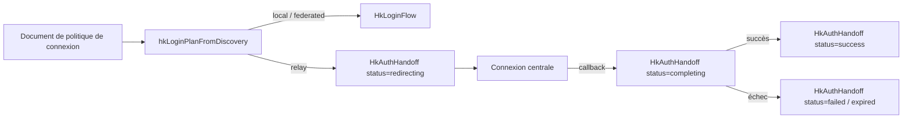

# Modes de connexion

Hikari fournit un seul flux de connexion (`HkLoginFlow`) et, autour de lui, trois éléments qui permettent à chaque front-end Celestia de monter la même interface de connexion à partir du document de politique de connexion du serveur : un adaptateur de découverte, un écran de relais et des lignes de canal capables de devenir de vrais liens.



## Les trois modes

| Mode | Formulaire de mot de passe | Lignes de fournisseur | Ce que l'hôte monte |
| --- | --- | --- | --- |
| `local` | Un canal d'identifiants | Toute entrée d'un type autre que `oauth` (aujourd'hui `passkey`, `custom`) | `HkLoginFlow` à un seul canal, sans groupe de segments |
| `federated`, `password: true` | Un canal d'identifiants | Toutes les méthodes (`oauth`, `passkey`, `custom`) sous le formulaire | `HkLoginFlow` à un seul canal |
| `federated`, `password: false` | Aucun | Chaque méthode devient son propre canal `sso` | `HkLoginFlow` avec un canal par méthode |
| `relay` | Aucun | Aucune | **Pas de `HkLoginFlow`** — `HkAuthHandoff` redirige vers la connexion centrale |

## Adaptateur de découverte

`loginDiscovery.ts` est un ensemble de fonctions pures : pas de réactivité, pas de point d'accès, pas de construction d'URL. Les types correspondent champ par champ au document transmis (`version`, `mode`, `password`, `methods[]`, `relay`).

```tsx
import {
  hkLoginPlanFromDiscovery, hkRelayEntryHref,
  HkAuthHandoff, HkLoginFlow,
} from "@celestia-island/hikari/vue";

const plan = hkLoginPlanFromDiscovery(policy, {
  credentialsKey: "cloud",          // par défaut "cloud"
  credentialsLabel: "Celestia",     // libellé de segment facultatif
  divider: "Autres moyens de connexion", // facultatif ; omis s'il n'est pas fourni
});
const channel = ref(plan.defaultChannel ?? "");
```

| Export | Résultat |
| --- | --- |
| `hkLoginPlanFromDiscovery(doc, copy?)` | `{ mode, channels, defaultChannel }` ; `channels` vaut `[]` et `defaultChannel` vaut `null` en mode relay |
| `hkRelayEntryHref(doc, returnTo?)` | `null` hors du mode relay ; sinon l'URL d'entrée, l'adresse de retour n'étant ajoutée que si c'est un chemin de même origine |
| `hkIsSameOriginPath(raw)` | `true` pour `/x` ; `false` pour `//host`, `/`, une URL relative ou absolue |

Les types de méthode inconnus et les méthodes sans `id` sont ignorés — l'adaptateur ne lève jamais d'exception sur un document qu'il ne comprend pas.

## Écran de relais

`HkAuthHandoff` est l'écran de connexion qui n'est pas un formulaire : l'interstitiel du mode relay, l'échange du callback et les états terminaux. Il repose sur `HkAuthScreen` et reprend la grammaire de la carte d'authentification (logo, titre, description).

```tsx
<HkAuthHandoff
  status={state}                 // "redirecting" | "completing" | "success" | "failed" | "expired"
  logoSrc="/logo.svg"
  href={entryHref ?? undefined}  // redirecting : la cible de navigation
  delayMs={600}
  onRedirect={(href) => allow(href)}  // renvoyer false pour annuler
  onRetry={() => restart()}
  onBack={() => router.push("/login")}
/>
```

| Propriété | Par défaut | Effet |
| --- | --- | --- |
| `status` | obligatoire | Spinner et région live polie pour `redirecting` / `completing` ; `role="alert"` pour `failed` / `expired` |
| `title` / `description` | `undefined` | Remplace le texte d'état de `hikari::authHandoff.*` ; pas de description par défaut |
| `logoSrc` | `undefined` | Pas de logo |
| `href` | `undefined` | S'il est fourni, le composant navigue après `delayMs` ; sinon l'hôte navigue sur `redirect` |
| `delayMs` | `0` | Durée d'affichage de l'interstitiel avant la navigation |
| `actions` | `["back"]` pour `failed` / `expired`, `[]` sinon | Boutons intégrés ; le slot `actions` les remplace |

Événements : `redirect(href)`, `retry()`, `back()`. Slots : `header`, `footer` (transmis à `HkAuthScreen`), `actions`.

## Lignes liens

Une `HkAuthChannelListEntry` — et une `HkLoginSsoChannel` qui la transmet — peut porter un `href`. La ligne s'affiche alors comme une vraie `<a href>` : le clic milieu et le Ctrl-clic fonctionnent et les robots voient la cible. `select(key)` (ou `sso-click`) se déclenche toujours en premier et la navigation n'est jamais empêchée. Un lien désactivé n'a pas de `href`, est ignoré comme un bouton désactivé et porte `aria-disabled="true"`. Sans `href`, la ligne reste un `<button type="button">`, comme avant.

## Responsabilités de l'hôte

- Valider le document de politique de connexion côté serveur ; hikari fait confiance à ce qu'on lui donne.
- En mode relay, ne pas monter `HkLoginFlow` — monter `HkAuthHandoff`.
- Ne passer que des chemins de même origine comme adresse de retour ; utiliser `hkIsSameOriginPath` ou votre propre liste d'autorisation.
- Les `href` des lignes doivent aussi être des chemins de même origine (le document est validé côté serveur) ; hikari ne les vérifie pas.
