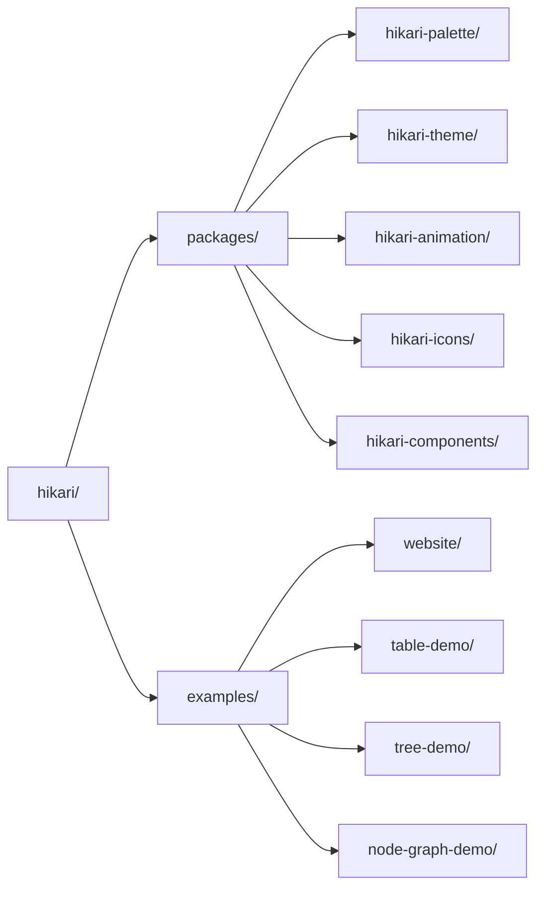

# Bibliothèque UI Hikari

> Une bibliothèque UI de nouvelle génération basée sur Tairitsu + Grass + Axum
>
> **Positionnement**: un seul design system, deux runtimes — Vue 3 et Rust/WASM

## Qu'est-ce que Hikari ?

Hikari est une bibliothèque UI de nouvelle génération. Un seul design system est livré sur deux runtimes de premier plan : les crates `hikari-*` pour Rust/WASM (sur le framework Tairitsu) et `@celestia-island/hikari` pour Vue 3. La bibliothèque adopte une conception modulaire, fournissant une bibliothèque de composants complète, un système de thèmes et un système d'animation ; ce même cœur de design évolue également vers les UI d'applications autonomes.

## Fonctionnalités Principales

### Palette & Thèmes
- **660+ Couleurs Curées**: collections historiques et modernes, constantes type-safe
- **Système de Thèmes**: thèmes clair/sombre intégrés et préréglages personnalisés
- **Type-Safe**: Vérification des valeurs de couleur à la compilation

### Riche Bibliothèque de Composants
- **Composants de Base**: Button, Input, Card, Badge
- **Composants de Feedback**: Alert, Toast, Tooltip, Spotlight
- **Composants de Navigation**: Menu, Tabs, Breadcrumb
- **Composants de Données**: Table, Tree, Pagination
- **Composants de Layout**: Layout, Header, Aside, Content, Footer

### Puissant Système d'Animation
- **Animations Déclaratives**: API fluent de type CSS
- **Valeurs Dynamiques**: Valeurs d'animation calculées à l'exécution
- **Fonctions d'Easing**: Plus de 30 fonctions d'easing
- **Animations Prédéfinies**: Fade, slide, scale, etc.

### Fonctionnalités Avancées
- **Rendu Côté Serveur**: Support SSR complet
- **Sécurité de Type**: Utilisation complète du système de types de Rust
- **Design Réactif**: Utilitaires de layout réactif intégrés
- **Système de Build**: Compilation SCSS automatisée et génération d'assets

## Démarrage Rapide

### Installer les Dépendances

Ajouter à `Cargo.toml`:

```toml
[dependencies]
hikari-components = "0.1"
hikari-palette = "0.1"
hikari-theme = "0.1"
tairitsu = "0.5"
```

### Utilisation de Base

```rust
use hikari_components::{ThemeProvider, Button};
use hikari_theme::ThemeProvider;

#[component]
fn App() -> Element {
    rsx! {
        ThemeProvider { initial_palette: "hikari" } {
            div { class: "hi-flex hi-flex-col hi-gap-4" {
                Button { label: "Cliquez-moi" }
                Button { label: "Bouton Principal", variant: "primary" }
                Button { label: "Bouton Secondaire", variant: "secondary" }
            }
        }
    }
}
```

### Compiler et Exécuter

```bash
# Mode développement
cargo run

# Build
cargo build --release

# Build WASM
trunk build --release
```

## Philosophie de Design

### Un Design System, Deux Runtimes
- Composants et tokens identiques pour les implémentations Vue 3 et Rust/WASM
- Un cœur SCSS partagé garantit une cohérence visuelle parfaite des deux côtés

### Précision et Clarté
- Surfaces plates et hiérarchie d'information claire
- Contraste élevé pour la lisibilité
- Accents et animations retenus et volontaires

### Conçu pour Aller Plus Loin
- Rendu côté serveur disponible dès aujourd'hui côté Rust
- Ce même cœur de design est destiné à s'étendre aux UI d'applications autonomes

## Structure du Projet



## Documentation

- [Composants](./components/) - Guide d'utilisation des composants UI
- [Système](./system/) - Architecture du système principal
- [Référence API](https://docs.rs/hikari-components) - Documentation API Rust

## Exemples

### Changement de Thème

```rust
use hikari_theme::ThemeProvider;

fn App() -> Element {
    let mut theme = use_signal(|| "hikari".to_string());

    rsx! {
        ThemeProvider { initial_palette: "{theme}" } {
            button {
                onclick: move |_| {
                    theme.set(if *theme() == "hikari" {
                        "tairitsu".to_string()
                    } else {
                        "hikari".to_string()
                    });
                },
                "Changer de Thème"
            }
        }
    }
}
```

### Utilisation des Animations

```rust
use hikari_animation::{AnimationBuilder, AnimationContext};
use hikari_animation::style::CssProperty;

// Animation statique
AnimationBuilder::new(&elements)
    .add_style("button", CssProperty::Opacity, "0.8")
    .apply_with_transition("300ms", "ease-in-out");

// Animation dynamique (suivi de souris)
AnimationBuilder::new(&elements)
    .add_style_dynamic("button", CssProperty::Transform, |ctx| {
        let x = ctx.mouse_x();
        let y = ctx.mouse_y();
        format!("translate({}px, {}px)", x, y)
    })
    .apply_with_transition("150ms", "ease-out");
```

## Contribution

Les contributions sont les bienvenues ! Veuillez lire [CONTRIBUTING.md](../../en/guides/CONTRIBUTING.md) pour plus de détails.

## Licence

[Synthetic Source License (SySL), Version 1.0](../../../LICENSE)

## Remerciements

- **Tairitsu** - Framework UI Rust puissant
- [Grass](https://github.com/kaj/kaj) - Compilateur SCSS pur en Rust
- [Element Plus](https://element-plus.org/) - Excellente référence de design de bibliothèque de composants
- [Material UI](https://mui.com/) - Inspiration de design UI moderne

---

**Hikari** - Un design system, tous les runtimes
