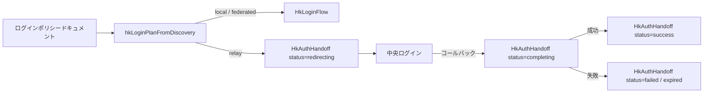

# ログインモード

Hikari はひとつのサインインフロー（`HkLoginFlow`）と、その周囲に三つの部品を提供します。これにより、すべての Celestia フロントエンドはサーバーのログインポリシードキュメントから同じログイン UI をマウントできます。ディスカバリアダプター、ハンドオフ画面、そして本物のリンクになれるチャネル行です。



## 三つのモード

| モード | パスワードフォーム | プロバイダー行 | ホストがマウントするもの |
| --- | --- | --- | --- |
| `local` | 認証情報チャネルひとつ | `oauth` 以外の種類の入口すべて（現在は `passkey`、`custom`） | チャネルひとつの `HkLoginFlow`。セグメントなし |
| `federated`、`password: true` | 認証情報チャネルひとつ | フォームの下にすべてのメソッド（`oauth`、`passkey`、`custom`） | チャネルひとつの `HkLoginFlow` |
| `federated`、`password: false` | なし | 各メソッドがそれぞれ `sso` チャネルになる | メソッドごとにチャネルを持つ `HkLoginFlow` |
| `relay` | なし | なし | **`HkLoginFlow` はマウントしない**——`HkAuthHandoff` が中央ログインへリダイレクト |

## ディスカバリアダプター

`loginDiscovery.ts` は純関数の集まりです。リアクティブなし、エンドポイントなし、URL の組み立てなし。型はワイヤードキュメント（`version`、`mode`、`password`、`methods[]`、`relay`）とフィールド単位で対応します。

```tsx
import {
  hkLoginPlanFromDiscovery, hkRelayEntryHref,
  HkAuthHandoff, HkLoginFlow,
} from "@celestia-island/hikari/vue";

const plan = hkLoginPlanFromDiscovery(policy, {
  credentialsKey: "cloud",          // 既定 "cloud"
  credentialsLabel: "Celestia",     // 任意のセグメントラベル
  divider: "他の方法でログイン",      // 任意。渡さなければ表示されない
});
const channel = ref(plan.defaultChannel ?? "");
```

| エクスポート | 結果 |
| --- | --- |
| `hkLoginPlanFromDiscovery(doc, copy?)` | `{ mode, channels, defaultChannel }`。relay モードでは `channels` は `[]`、`defaultChannel` は `null` |
| `hkRelayEntryHref(doc, returnTo?)` | relay モード以外では `null`。それ以外はエントリ URL を返し、戻り先が同一オリジンのパスのときだけ追加する |
| `hkIsSameOriginPath(raw)` | `/x` は `true`。`//host`、`/`、相対・絶対 URL、およびバックスラッシュ・制御文字・表示を組み替える書式文字を含むパスは `false`（kirino がナビゲーション先に適用するのと同じ規則） |

不明なメソッド種別や `id` が空のメソッドは無視されます。アダプターは理解できないドキュメントに対して決して例外を投げません。

## ハンドオフ画面

`HkAuthHandoff` はフォームではないサインイン画面です。relay のスプラッシュ、コールバックの交換、そして終端状態を担います。`HkAuthScreen` の上に構築され、認証カードの文法（logo、タイトル、説明）を使います。

```tsx
<HkAuthHandoff
  status={state}                 // "redirecting" | "completing" | "success" | "failed" | "expired"
  logoSrc="/logo.svg"
  href={entryHref ?? undefined}  // redirecting: 遷移先
  delayMs={600}
  onRedirect={(href) => allow(href)}  // false を返すとキャンセル
  onRetry={() => restart()}
  onBack={() => router.push("/login")}
/>
```

| プロップ | 既定値 | 効果 |
| --- | --- | --- |
| `status` | 必須 | `redirecting` / `completing`: スピナーと丁寧なライブリージョン。`failed` / `expired`: `role="alert"` |
| `title` / `description` | `undefined` | `hikari::authHandoff.*` の状態文言を上書き。説明は既定ではなし |
| `logoSrc` | `undefined` | ロゴなし |
| `href` | `undefined` | 指定すると `delayMs` 後に遷移。未指定ならホストが `redirect` で遷移する |
| `delayMs` | `0` | スプラッシュを表示してから遷移するまでの時間 |
| `actions` | `failed` / `expired` は `["back"]`、それ以外は `[]` | 組み込みボタン。`actions` スロットが置き換える |

イベント: `redirect(href)`、`retry()`、`back()`。スロット: `header`、`footer`（`HkAuthScreen` へ転送）、`actions`。

## リンク行

`HkAuthChannelListEntry`、およびそれを転送する `HkLoginSsoChannel` は `href` を持てます。その行は本物の `<a href>` として描画されます。中クリックと Ctrl クリックが機能し、クローラーもリンク先を認識します。`select(key)`（または `sso-click`）は先に発火し、ナビゲーションは決して妨げられません。無効なリンクには `href` がなく、無効なボタンと同様にスキップされ、`aria-disabled="true"` を持ちます。`href` がなければ行は以前どおり `<button type="button">` です。

## ホストの責務

- ログインポリシードキュメントはサーバー側で検証する。hikari は渡されたものを信頼する。
- relay モードでは `HkLoginFlow` をマウントせず、`HkAuthHandoff` をマウントする。
- 戻り先として渡すのは同一オリジンのパスのみ。`hkIsSameOriginPath` か独自の許可リストを使う。
- 行の `href` も同一オリジンのパスでなければなりません（文書はサーバー側で検証されます）。hikari は検査しません。

## 内蔵の中央 ID プロバイダー行の既定表示

中央 ID プロバイダー（ログインポリシー文書の `provider: "erp"`）はワイヤ上に自前の名前もアイコンも持たないため、これまで各ホストが独自に用意していた——行に裸の `erp` を出すか、「Celestia ID」と手書きしてアイコンを付けないか。hikari はその両方の既定値を提供する:

- **名前** —— `hkCentralAuthName()`、または手書きする `t(HK_CENTRAL_AUTH_NAME_KEY, HK_CENTRAL_AUTH_NAME_EN)`（`hikari::loginFlow.providerCelestiaAuth`、11 言語すべてに収録）。`hkCentralAuthName()` を推奨する。hikari 自身のロケール文脈から読むため、`hikari::` キーをマージしていないホストの i18n カタログでも翻訳されたままになる。レンダー関数または `computed` 内で呼び、モジュール先頭で値を持たないこと。
- **アイコン** —— `hkCentralAuthMarkSrc`、64×64 のインライン WebP data URI。16×16 で描画する。元画像は周囲のグリフと同じ光学サイズになるよう余白を持たせてある。

運用者の設定が常に優先される: デプロイ設定で与えた provider の `label` や `icon` を置き換えることはない。内蔵名を使うのは label が id に退化しているときだけ（`hkProviderLabelIsId` で判定）、内蔵アイコンを使うのはサーバーが icon を渡さなかったときだけ。この provider を設定していないデプロイは一切変わらない——セルフホストの既定は従来どおりローカルのユーザー名／パスワード。

さらにもう一つ、ハンドオフに由来する描画規則がある: リダイレクト（sso）チャネルは本来二段目を持たないため、`step="verify"` を渡すとフェイルセーフとしてアカウント本文を表示する。OAuth のハンドオフで二段階認証の因子表を受け取ったホストが `verifyFactors` を渡した場合、その sso チャネルは資格情報チャネルと同じく検証ステップを描画する——さもなければ「SSO のみ＋MFA」のデプロイは行き止まりになる。
