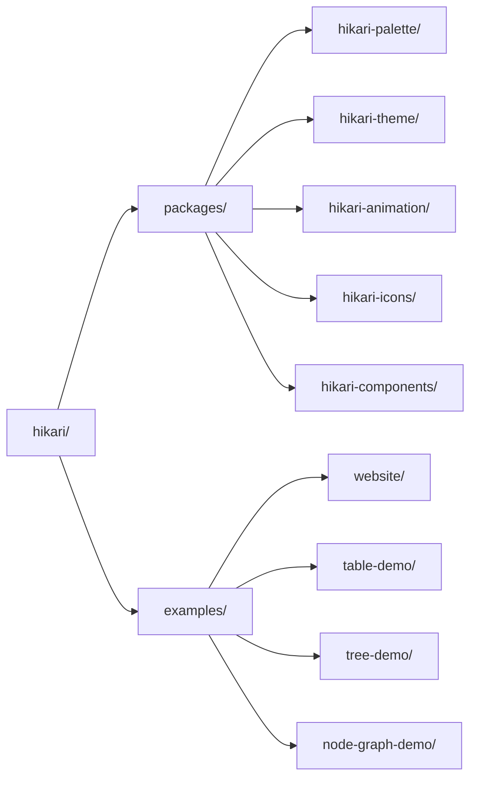

# Hikari UI ライブラリ

> Tairitsu + Grass + Axum で構築された次世代 UI ライブラリ
>
> **ポジショニング**: ひとつのデザインシステム、2 つのランタイム —— Vue 3 と Rust/WASM

## Hikariとは？

Hikari は次世代の UI ライブラリです。ひとつのデザインシステムが、Tairitsu フレームワーク上の Rust/WASM 向け `hikari-*` クレートと、Vue 3 向け `@celestia-island/hikari` という 2 つの第一級ランタイムに同時提供されます。モジュラー設計により、完全なコンポーネントライブラリ、テーマシステム、アニメーションシステムを提供し、同じデザインコアはスタンドアロンアプリケーション UI への道も歩んでいます。

## 主な機能

### パレットとテーマ
- **660種類以上の厳選された色**: 歴史的・現代的なコレクション、型安全な定数
- **テーマシステム**: ライト/ダーク内蔵テーマとカスタムプリセット
- **型安全性**: コンパイル時の色値チェック

### 豊富なコンポーネントライブラリ
- **基本コンポーネント**: Button, Input, Card, Badge
- **フィードバックコンポーネント**: Alert, Toast, Tooltip, Spotlight
- **ナビゲーションコンポーネント**: Menu, Tabs, Breadcrumb
- **データコンポーネント**: Table, Tree, Pagination
- **レイアウトコンポーネント**: Layout, Header, Aside, Content, Footer

### 強力なアニメーションシステム
- **宣言的アニメーション**: CSSライクなfluent API
- **動的値**: 実行時計算されるアニメーション値
- **イージング関数**: 30種類以上のイージング関数
- **プリセットアニメーション**: フェード、スライド、スケールなど

### 高度な機能
- **サーバーサイドレンダリング**: 完全なSSRサポート
- **型安全性**: Rustの型システムを完全に活用
- **レスポンシブデザイン**: 組み込みのレスポンシブレイアウトユーティリティ
- **ビルドシステム**: 自動SCSSコンパイルとアセット生成

## クイックスタート

### 依存関係のインストール

`Cargo.toml`に追加:

```toml
[dependencies]
hikari-components = "0.1"
hikari-palette = "0.1"
hikari-theme = "0.1"
tairitsu = "0.5"
```

### 基本的な使用方法

```rust
use hikari_components::{ThemeProvider, Button};
use hikari_theme::ThemeProvider;

#[component]
fn App() -> Element {
    rsx! {
        ThemeProvider { initial_palette: "hikari" } {
            div { class: "hi-flex hi-flex-col hi-gap-4" {
                Button { label: "クリックして" }
                Button { label: "プライマリボタン", variant: "primary" }
                Button { label: "セカンダリボタン", variant: "secondary" }
            }
        }
    }
}
```

### ビルドと実行

```bash
# 開発モード
cargo run

# ビルド
cargo build --release

# WASM ビルド
trunk build --release
```

## デザイン哲学

### ひとつのデザインシステム、2 つのランタイム
- Vue 3 と Rust/WASM の実装が同じコンポーネントとトークンを共有
- 共有 SCSS コアが両側の視覚的な完全な一致を保証

### 精度と明確さ
- フラットな面と明確な情報階層
- 読みやすさを重視した高コントラスト
- 抑えながらも目的のあるアクセントとモーション

### さらに先へ
- Rust 側では本日からサーバーサイドレンダリングをサポート
- 同じデザインコアはスタンドアロンアプリケーション UI へと発展していく設計

## プロジェクト構造



## ドキュメント

- [コンポーネント](./components/) - UIコンポーネント使用ガイド
- [システム](./system/) - コアシステムアーキテクチャ
- [API リファレンス](https://docs.rs/hikari-components) - Rust API ドキュメント

## 例

### テーマ切り替え

```rust
use hikari_theme::ThemeProvider;

fn App() -> Element {
    let mut theme = use_signal(|| "hikari".to_string());

    rsx! {
        ThemeProvider { initial_palette: "{theme}" } {
            button {
                onclick: move |_| {
                    theme.set(if *theme() == "hikari" {
                        "tairitsu".to_string()
                    } else {
                        "hikari".to_string()
                    });
                },
                "テーマ切り替え"
            }
        }
    }
}
```

### アニメーションの使用

```rust
use hikari_animation::{AnimationBuilder, AnimationContext};
use hikari_animation::style::CssProperty;

// 静的アニメーション
AnimationBuilder::new(&elements)
    .add_style("button", CssProperty::Opacity, "0.8")
    .apply_with_transition("300ms", "ease-in-out");

// 動的アニメーション（マウス追従）
AnimationBuilder::new(&elements)
    .add_style_dynamic("button", CssProperty::Transform, |ctx| {
        let x = ctx.mouse_x();
        let y = ctx.mouse_y();
        format!("translate({}px, {}px)", x, y)
    })
    .apply_with_transition("150ms", "ease-out");
```

## コントリビュート

コントリビュートは大歓迎です！詳細は [CONTRIBUTING.md](../../en/guides/CONTRIBUTING.md) をお読みください。

## ライセンス

[Synthetic Source License (SySL), Version 1.0](../../../LICENSE)

## 謝辞

- **Tairitsu** - 強力な Rust UI フレームワーク
- [Grass](https://github.com/kaj/kaj) - 純粋な Rust SCSS コンパイラ
- [Element Plus](https://element-plus.org/) - 優れたコンポーネントライブラリデザイン参考
- [Material UI](https://mui.com/) - モダンな UI デザインインスピレーション

---

**Hikari** - ひとつのデザインシステム、すべてのランタイムへ
