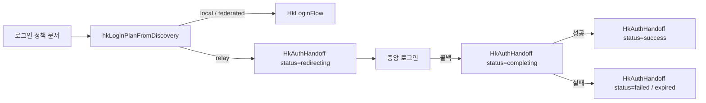

# 로그인 모드

Hikari는 하나의 로그인 흐름(`HkLoginFlow`)과, 그 주변의 세 가지 요소를 제공하여 모든 Celestia 프런트엔드가 서버의 로그인 정책 문서로부터 같은 로그인 UI를 마운트할 수 있게 합니다. 디스커버리 어댑터, 핸드오프 화면, 그리고 실제 링크가 될 수 있는 채널 행입니다.



## 세 가지 모드

| 모드 | 비밀번호 폼 | 공급자 행 | 호스트가 마운트하는 것 |
| --- | --- | --- | --- |
| `local` | 자격 증명 채널 하나 | `oauth`가 아닌 모든 종류의 입구 (현재 `passkey`, `custom`) | 채널 하나뿐인 `HkLoginFlow`. 세그먼트 그룹 없음 |
| `federated`, `password: true` | 자격 증명 채널 하나 | 폼 아래에 모든 방법 (`oauth`, `passkey`, `custom`) | 채널 하나뿐인 `HkLoginFlow` |
| `federated`, `password: false` | 없음 | 각 방법이 각자 `sso` 채널이 됨 | 방법마다 채널이 하나씩인 `HkLoginFlow` |
| `relay` | 없음 | 없음 | **`HkLoginFlow`를 마운트하지 않음** — `HkAuthHandoff`가 중앙 로그인으로 이동 |

## 디스커버리 어댑터

`loginDiscovery.ts`는 순수 함수 집합입니다. 반응성 없음, 엔드포인트 없음, URL 조립 없음. 타입은 와이어 문서(`version`, `mode`, `password`, `methods[]`, `relay`)와 필드 단위로 일치합니다.

```tsx
import {
  hkLoginPlanFromDiscovery, hkRelayEntryHref,
  HkAuthHandoff, HkLoginFlow,
} from "@celestia-island/hikari/vue";

const plan = hkLoginPlanFromDiscovery(policy, {
  credentialsKey: "cloud",          // 기본값 "cloud"
  credentialsLabel: "Celestia",     // 선택적 세그먼트 라벨
  divider: "다른 방법으로 로그인",    // 선택적. 전달하지 않으면 렌더링되지 않음
});
const channel = ref(plan.defaultChannel ?? "");
```

| 내보내기 | 결과 |
| --- | --- |
| `hkLoginPlanFromDiscovery(doc, copy?)` | `{ mode, channels, defaultChannel }`. relay 모드에서는 `channels`가 `[]`, `defaultChannel`이 `null` |
| `hkRelayEntryHref(doc, returnTo?)` | relay 모드가 아니면 `null`. 그 외에는 진입 URL을 반환하며, 돌아갈 주소가 같은 출처 경로일 때만 덧붙임 |
| `hkIsSameOriginPath(raw)` | `/x`는 `true`. `//host`, `/`, 상대·절대 URL, 그리고 백슬래시·제어 문자·표시를 바꾸는 서식 문자가 들어 있는 경로는 `false` (kirino가 탐색 대상에 적용하는 것과 같은 규칙) |

알 수 없는 방법 종류와 `id`가 비어 있는 방법은 무시됩니다. 어댑터는 이해하지 못하는 문서 때문에 예외를 던지지 않습니다.

## 핸드오프 화면

`HkAuthHandoff`는 폼이 아닌 로그인 화면입니다. relay 스플래시, 콜백 교환, 그리고 종결 상태를 담당합니다. `HkAuthScreen` 위에 구축되며 인증 카드 문법(logo, 제목, 설명)을 사용합니다.

```tsx
<HkAuthHandoff
  status={state}                 // "redirecting" | "completing" | "success" | "failed" | "expired"
  logoSrc="/logo.svg"
  href={entryHref ?? undefined}  // redirecting: 이동 대상
  delayMs={600}
  onRedirect={(href) => allow(href)}  // false를 반환하면 취소
  onRetry={() => restart()}
  onBack={() => router.push("/login")}
/>
```

| 속성 | 기본값 | 효과 |
| --- | --- | --- |
| `status` | 필수 | `redirecting` / `completing`: 스피너와 정중한 라이브 영역. `failed` / `expired`: `role="alert"` |
| `title` / `description` | `undefined` | `hikari::authHandoff.*`의 상태 문구를 덮어씀. 설명은 기본적으로 없음 |
| `logoSrc` | `undefined` | 로고 없음 |
| `href` | `undefined` | 지정하면 `delayMs` 후 이동. 지정하지 않으면 호스트가 `redirect`에서 이동 |
| `delayMs` | `0` | 스플래시를 보여 준 뒤 이동하기까지의 시간 |
| `actions` | `failed` / `expired`는 `["back"]`, 나머지는 `[]` | 기본 제공 버튼. `actions` 슬롯이 이를 대체 |

이벤트: `redirect(href)`, `retry()`, `back()`. 슬롯: `header`, `footer`(`HkAuthScreen`으로 전달), `actions`.

## 링크 행

`HkAuthChannelListEntry`와 이를 전달하는 `HkLoginSsoChannel`은 `href`를 가질 수 있습니다. 그러면 해당 행은 실제 `<a href>`로 렌더링됩니다. 가운데 클릭과 Ctrl 클릭이 동작하고 크롤러도 대상을 볼 수 있습니다. `select(key)`(또는 `sso-click`)는 여전히 먼저 발생하며 내비게이션은 결코 막히지 않습니다. 비활성 링크에는 `href`가 없고, 비활성 버튼과 마찬가지로 건너뛰며 `aria-disabled="true"`를 가집니다. `href`가 없으면 행은 이전처럼 `<button type="button">`입니다.

## 호스트의 책임

- 로그인 정책 문서는 서버에서 검증한다. hikari는 전달받은 것을 신뢰한다.
- relay 모드에서는 `HkLoginFlow`를 마운트하지 않고 `HkAuthHandoff`를 마운트한다.
- 돌아갈 주소로는 같은 출처 경로만 전달한다. `hkIsSameOriginPath` 또는 자체 허용 목록을 사용한다.
- 행의 `href`도 같은 출처 경로여야 한다(문서는 서버에서 검증된다). hikari는 이를 검사하지 않는다.

## 내장 중앙 신원 제공자 행의 기본 표시

중앙 신원 제공자(로그인 정책 문서의 `provider: "erp"`)는 프로토콜상 자체 이름도 아이콘도 없어서, 지금까지 각 호스트가 알아서 만들었다—행에 `erp`만 노출하거나, "Celestia ID"를 직접 적고 아이콘은 두지 않았다. hikari가 그 두 가지 기본값을 함께 제공한다:

- **이름** — `hkCentralAuthName()`, 또는 직접 쓰던 `t(HK_CENTRAL_AUTH_NAME_KEY, HK_CENTRAL_AUTH_NAME_EN)`(`hikari::loginFlow.providerCelestiaAuth`, 11개 언어 모두 제공). `hkCentralAuthName()`을 권장한다. hikari 자체의 로케일 컨텍스트를 읽으므로, `hikari::` 키를 병합하지 않은 호스트의 i18n 카탈로그에서도 번역된 이름이 유지된다. 렌더 함수나 `computed` 안에서 호출하고, 모듈 최상위에서 값을 고정하지 말 것.
- **아이콘** — `hkCentralAuthMarkSrc`, 64×64 인라인 WebP data URI. 16×16으로 렌더링한다. 원본에는 주변 글리프와 같은 광학 크기가 되도록 여백이 들어 있다.

운영자 설정이 언제나 우선한다: 배포 설정에서 지정한 provider `label`이나 `icon`은 절대 덮어쓰지 않는다. 내장 이름은 label이 id로 퇴화했을 때만(`hkProviderLabelIsId`로 판정), 내장 아이콘은 서버가 icon을 주지 않았을 때만 쓴다. 이 provider를 설정하지 않은 배포는 아무것도 달라지지 않는다—셀프 호스팅 기본값은 여전히 로컬 사용자 이름/비밀번호다.

핸드오프에서 나오는 표시 규칙이 하나 더 있다: 리다이렉트(sso) 채널은 원래 두 번째 단계가 없으므로 `step="verify"`를 넘기면 안전장치로 계정 본문을 보여 준다. OAuth 핸드오프로 2차 인증 요소 목록을 받은 호스트가 `verifyFactors`를 넘기면, 그 sso 채널은 자격 증명 채널처럼 검증 단계를 렌더링한다—그렇지 않으면 "SSO 전용 + MFA" 배포가 막다른 길에 빠진다.
