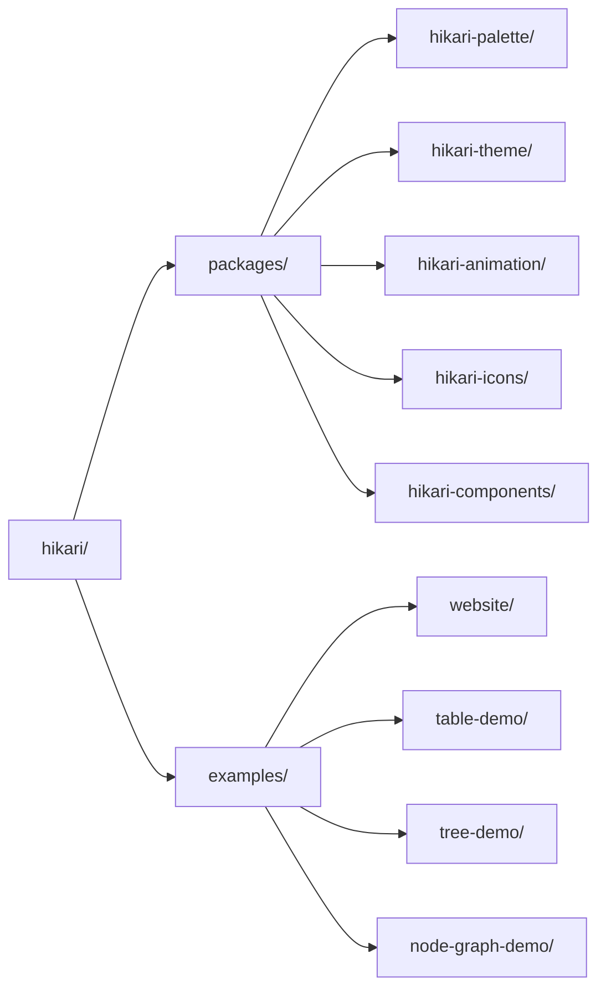

# Hikari UI 라이브러리

> Tairitsu + Grass + Axum 기반의 차세대 UI 라이브러리
>
> **포지셔닝**: 하나의 디자인 시스템, 두 개의 런타임 — Vue 3와 Rust/WASM

## Hikari란?

Hikari는 차세대 UI 라이브러리입니다. 하나의 디자인 시스템이 두 개의 first-class 런타임에 동시에 제공됩니다. Tairitsu 프레임워크 기반의 Rust/WASM용 `hikari-*` 크레이트와 Vue 3용 `@celestia-island/hikari`입니다. 모듈식 설계로 완전한 컴포넌트 라이브러리, 테마 시스템, 애니메이션 시스템을 제공하며, 동일한 디자인 코어는 독립 실행형 애플리케이션 UI로도 발전해 나갑니다.

## 핵심 기능

### 팔레트와 테마
- **660+ 엄선된 색상**: 역사적·현대적 컬렉션, 타입 안전 상수
- **테마 시스템**: 기본 제공 라이트/다크 테마 및 커스텀 프리셋
- **타입 안전**: 컴파일 시간 검증 색상 값

### 풍부한 컴포넌트 라이브러리
- **기본 컴포넌트**: Button, Input, Card, Badge
- **피드백 컴포넌트**: Alert, Toast, Tooltip, Spotlight
- **내비게이션 컴포넌트**: Menu, Tabs, Breadcrumb
- **데이터 컴포넌트**: Table, Tree, Pagination
- **레이아웃 컴포넌트**: Layout, Header, Aside, Content, Footer

### 강력한 애니메이션 시스템
- **선언적 애니메이션**: CSS 스타일의 유창한 API
- **동적 값**: 런타임 계산 애니메이션 값
- **이징 함수**: 30+ 이징 함수
- **프리셋 애니메이션**: 페이드, 슬라이드, 스케일 등

### 고급 기능
- **서버 사이드 렌더링**: 완전한 SSR 지원
- **타입 안전**: Rust 타입 시스템의 완전한 활용
- **반응형 디자인**: 기본 제공 반응형 레이아웃 유틸리티
- **빌드 시스템**: 자동화된 SCSS 컴파일 및 에셋 생성

## 빠른 시작

### 의존성 설치

`Cargo.toml`에 추가:

```toml
[dependencies]
hikari-components = "0.1"
hikari-palette = "0.1"
hikari-theme = "0.1"
tairitsu = "0.5"
```

### 기본 사용법

```rust
use hikari_components::{ThemeProvider, Button};
use hikari_theme::ThemeProvider;

#[component]
fn App() -> Element {
    rsx! {
        ThemeProvider { initial_palette: "hikari" } {
            div { class: "hi-flex hi-flex-col hi-gap-4" {
                Button { label: "클릭하세요" }
                Button { label: "기본 버튼", variant: "primary" }
                Button { label: "보조 버튼", variant: "secondary" }
            }
        }
    }
}
```

### 빌드 및 실행

```bash
# 개발 모드
cargo run

# 빌드
cargo build --release

# WASM 빌드
trunk build --release
```

## 디자인 철학

### 하나의 디자인 시스템, 두 개의 런타임
- Vue 3와 Rust/WASM 구현이 동일한 컴포넌트와 토큰을 공유
- 공유 SCSS 코어가 양쪽의 시각적 완전한 일치를 보장

### 정확성과 명확성
- 플랫한 표면과 명확한 정보 계층
- 가독성을 위한 높은 대비
- 절제되고 목적 있는 강조와 모션

### 더 멀리 나아가도록
- Rust 측은 이미 서버 사이드 렌더링 지원
- 동일한 디자인 코어는 독립 실행형 애플리케이션 UI로 발전할 예정

## 프로젝트 구조



## 문서

- [컴포넌트](./components/) - UI 컴포넌트 사용 가이드
- [시스템](./system/) - 핵심 시스템 아키텍처
- [API 레퍼런스](https://docs.rs/hikari-components) - Rust API 문서

## 예제

### 테마 전환

```rust
use hikari_theme::ThemeProvider;

fn App() -> Element {
    let mut theme = use_signal(|| "hikari".to_string());

    rsx! {
        ThemeProvider { initial_palette: "{theme}" } {
            button {
                onclick: move |_| {
                    theme.set(if *theme() == "hikari" {
                        "tairitsu".to_string()
                    } else {
                        "hikari".to_string()
                    });
                },
                "테마 전환"
            }
        }
    }
}
```

### 애니메이션 사용

```rust
use hikari_animation::{AnimationBuilder, AnimationContext};
use hikari_animation::style::CssProperty;

// 정적 애니메이션
AnimationBuilder::new(&elements)
    .add_style("button", CssProperty::Opacity, "0.8")
    .apply_with_transition("300ms", "ease-in-out");

// 동적 애니메이션 (마우스 추적)
AnimationBuilder::new(&elements)
    .add_style_dynamic("button", CssProperty::Transform, |ctx| {
        let x = ctx.mouse_x();
        let y = ctx.mouse_y();
        format!("translate({}px, {}px)", x, y)
    })
    .apply_with_transition("150ms", "ease-out");
```

## 기여

기여를 환영합니다! 자세한 내용은 [CONTRIBUTING.md](../../en/guides/CONTRIBUTING.md)를 참조하세요.

## 라이선스

[Synthetic Source License (SySL), Version 1.0](../../../LICENSE)

## 감사의 말

- **Tairitsu** - 강력한 Rust UI 프레임워크
- [Grass](https://github.com/kaj/kaj) - 순수 Rust SCSS 컴파일러
- [Element Plus](https://element-plus.org/) - 훌륭한 컴포넌트 라이브러리 디자인 참조
- [Material UI](https://mui.com/) - 현대적인 UI 디자인 영감

---

**Hikari** - 하나의 디자인 시스템, 모든 런타임으로
