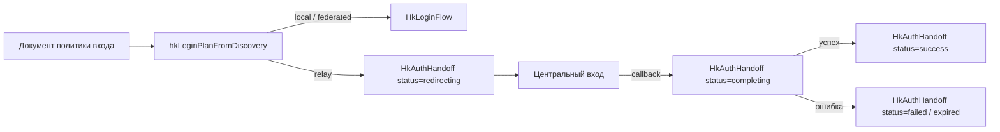

# Режимы входа

Hikari поставляет один поток входа (`HkLoginFlow`) и три элемента вокруг него, которые позволяют каждому фронтенду Celestia монтировать один и тот же интерфейс входа из документа политики входа сервера: адаптер обнаружения, экран передачи и строки каналов, способные становиться настоящими ссылками.



## Три режима

| Режим | Форма пароля | Строки провайдеров | Что монтирует хост |
| --- | --- | --- | --- |
| `local` | Один канал учётных данных | Все входы видов, отличных от `oauth` (сейчас `passkey`, `custom`) | `HkLoginFlow` с одним каналом, без группы сегментов |
| `federated`, `password: true` | Один канал учётных данных | Все методы (`oauth`, `passkey`, `custom`) под формой | `HkLoginFlow` с одним каналом |
| `federated`, `password: false` | Нет | Каждый метод становится своим каналом `sso` | `HkLoginFlow` с каналом на каждый метод |
| `relay` | Нет | Нет | **Без `HkLoginFlow`** — `HkAuthHandoff` выполняет переход на центральный вход |

## Адаптер обнаружения

`loginDiscovery.ts` — набор чистых функций: без реактивности, без запросов, без сборки URL. Типы соответствуют документу поле в поле (`version`, `mode`, `password`, `methods[]`, `relay`).

```tsx
import {
  hkLoginPlanFromDiscovery, hkRelayEntryHref,
  HkAuthHandoff, HkLoginFlow,
} from "@celestia-island/hikari/vue";

const plan = hkLoginPlanFromDiscovery(policy, {
  credentialsKey: "cloud",          // по умолчанию "cloud"
  credentialsLabel: "Celestia",     // необязательная подпись сегмента
  divider: "Другие способы входа",  // необязательно; без него не отображается
});
const channel = ref(plan.defaultChannel ?? "");
```

| Экспорт | Результат |
| --- | --- |
| `hkLoginPlanFromDiscovery(doc, copy?)` | `{ mode, channels, defaultChannel }`; в режиме relay `channels` — это `[]`, а `defaultChannel` — `null` |
| `hkRelayEntryHref(doc, returnTo?)` | `null` вне режима relay; иначе URL точки входа, адрес возврата добавляется только если это путь того же источника |
| `hkIsSameOriginPath(raw)` | `true` для `/x`; `false` для `//host`, `/`, относительных и абсолютных URL, а также для любого пути с обратной косой чертой, управляющим символом или форматирующим символом, меняющим отображение (то же правило, что kirino применяет к целям навигации) |

Неизвестные типы методов и методы с пустым `id` игнорируются — адаптер никогда не выбрасывает исключение на документе, который не понимает.

## Экран передачи

`HkAuthHandoff` — экран входа, не являющийся формой: заставка режима relay, обмен callback и конечные состояния. Построен на `HkAuthScreen` и использует грамматику карточки входа (логотип, заголовок, описание).

```tsx
<HkAuthHandoff
  status={state}                 // "redirecting" | "completing" | "success" | "failed" | "expired"
  logoSrc="/logo.svg"
  href={entryHref ?? undefined}  // redirecting: цель перехода
  delayMs={600}
  onRedirect={(href) => allow(href)}  // верните false, чтобы отменить
  onRetry={() => restart()}
  onBack={() => router.push("/login")}
/>
```

| Свойство | По умолчанию | Действие |
| --- | --- | --- |
| `status` | обязательно | Спиннер и вежливая live-область для `redirecting` / `completing`; `role="alert"` для `failed` / `expired` |
| `title` / `description` | `undefined` | Переопределяет текст состояния из `hikari::authHandoff.*`; описание по умолчанию отсутствует |
| `logoSrc` | `undefined` | Без логотипа |
| `href` | `undefined` | Если задан, компонент выполняет переход после `delayMs`; иначе хост переходит по `redirect` |
| `delayMs` | `0` | Сколько показывать заставку перед переходом |
| `actions` | `["back"]` для `failed` / `expired`, `[]` иначе | Встроенные кнопки; слот `actions` заменяет их |

События: `redirect(href)`, `retry()`, `back()`. Слоты: `header`, `footer` (передаются в `HkAuthScreen`), `actions`.

## Строки-ссылки

`HkAuthChannelListEntry` — и передающий её `HkLoginSsoChannel` — может содержать `href`. Тогда строка отображается как настоящая `<a href>`: клик средней кнопкой и Ctrl-клик работают, краулеры видят цель. `select(key)` (или `sso-click`) по-прежнему срабатывает первым, и переход никогда не блокируется. Отключённая ссылка не имеет `href`, пропускается как отключённая кнопка и несёт `aria-disabled="true"`. Без `href` строка остаётся `<button type="button">`, как и раньше.

## Обязанности хоста

- Проверяйте документ политики входа на сервере; hikari доверяет тому, что ему передали.
- В режиме relay не монтируйте `HkLoginFlow` — монтируйте `HkAuthHandoff`.
- Передавайте в качестве адреса возврата только пути того же источника; используйте `hkIsSameOriginPath` или собственный список разрешений.
- `href` строк тоже должен быть путём того же источника (документ проверяется на сервере); hikari его не проверяет.
