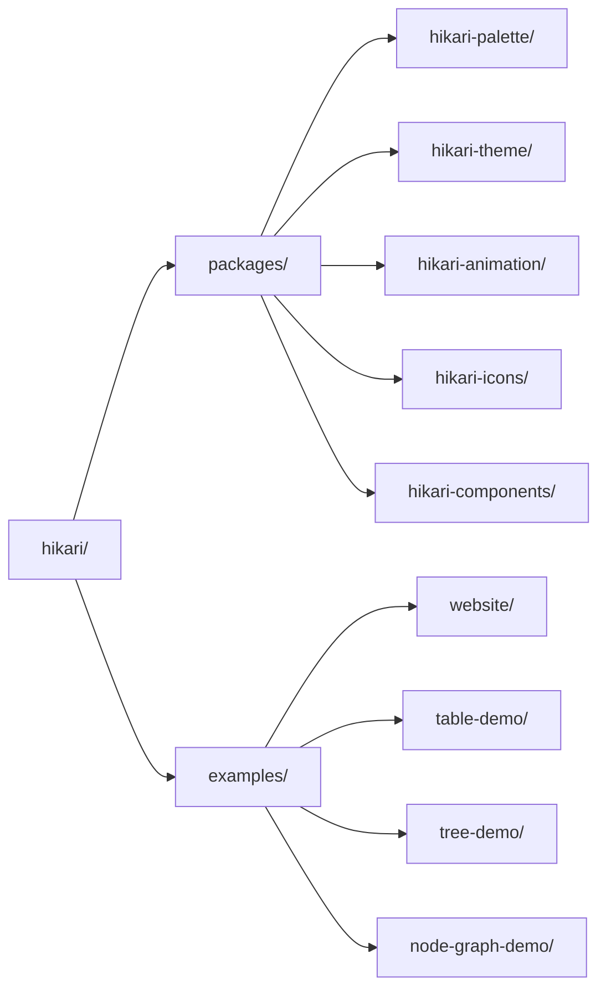

# Библиотека UI Hikari

> Библиотека UI нового поколения, построенная на Tairitsu + Grass + Axum
>
> **Позиционирование**: одна дизайн-система, две среды исполнения — Vue 3 и Rust/WASM

## Что такое Hikari?

Hikari — это библиотека UI нового поколения. Одна дизайн-система поставляется сразу в две первоклассные среды исполнения: крейты `hikari-*` для Rust/WASM (на фреймворке Tairitsu) и `@celestia-island/hikari` для Vue 3. Библиотека использует модульный подход, предоставляя полную библиотеку компонентов, систему тем и систему анимаций; то же дизайнерское ядро развивается и в сторону UI автономных приложений.

## Основные возможности

### Палитра и темы
- **660+ отобранных цветов**: исторические и современные коллекции, типобезопасные константы
- **Система тем**: Встроенные светлые/тёмные темы и пользовательские пресеты
- **Типобезопасность**: Проверка значений цветов во время компиляции

### Богатая библиотека компонентов
- **Базовые компоненты**: Button, Input, Card, Badge
- **Компоненты обратной связи**: Alert, Toast, Tooltip, Spotlight
- **Навигационные компоненты**: Menu, Tabs, Breadcrumb
- **Компоненты данных**: Table, Tree, Pagination
- **Компоненты раскладки**: Layout, Header, Aside, Content, Footer

### Мощная система анимаций
- **Декларативные анимации**: Fluent API в стиле CSS
- **Динамические значения**: Вычисляемые во время выполнения значения анимаций
- **Функции сглаживания**: 30+ функций сглаживания
- **Готовые анимации**: Затухание, скольжение, масштабирование и т.д.

### Продвинутые возможности
- **Серверный рендеринг**: Полная поддержка SSR
- **Типобезопасность**: Полное использование системы типов Rust
- **Адаптивный дизайн**: Встроенные утилиты адаптивной раскладки
- **Система сборки**: Автоматическая компиляция SCSS и генерация ресурсов

## Быстрый старт

### Установка зависимостей

Добавьте в `Cargo.toml`:

```toml
[dependencies]
hikari-components = "0.1"
hikari-palette = "0.1"
hikari-theme = "0.1"
tairitsu = "0.5"
```

### Базовое использование

```rust
use hikari_components::{ThemeProvider, Button};
use hikari_theme::ThemeProvider;

#[component]
fn App() -> Element {
    rsx! {
        ThemeProvider { initial_palette: "hikari" } {
            div { class: "hi-flex hi-flex-col hi-gap-4" {
                Button { label: "Нажми меня" }
                Button { label: "Основная кнопка", variant: "primary" }
                Button { label: "Вторичная кнопка", variant: "secondary" }
            }
        }
    }
}
```

### Сборка и запуск

```bash
# Режим разработки
cargo run

# Сборка
cargo build --release

# Сборка WASM
trunk build --release
```

## Философия дизайна

### Одна дизайн-система, две среды исполнения
- Реализации Vue 3 и Rust/WASM используют одни и те же компоненты и токены
- Общее SCSS-ядро гарантирует полное визуальное совпадение обеих сторон

### Точность и ясность
- Плоские поверхности и чёткая иерархия информации
- Высокий контраст для читаемости
- Сдержанные и целесообразные акценты и анимации

### Создано, чтобы идти дальше
- Серверный рендеринг на стороне Rust доступен уже сегодня
- То же дизайнерское ядро предназначено для расширения на UI автономных приложений

## Структура проекта



## Документация

- [Компоненты](./components/) - Руководство по использованию UI-компонентов
- [Система](./system/) - Архитектура основных систем
- [API Reference](https://docs.rs/hikari-components) - Документация Rust API

## Примеры

### Переключение темы

```rust
use hikari_theme::ThemeProvider;

fn App() -> Element {
    let mut theme = use_signal(|| "hikari".to_string());

    rsx! {
        ThemeProvider { initial_palette: "{theme}" } {
            button {
                onclick: move |_| {
                    theme.set(if *theme() == "hikari" {
                        "tairitsu".to_string()
                    } else {
                        "hikari".to_string()
                    });
                },
                "Переключить тему"
            }
        }
    }
}
```

### Использование анимаций

```rust
use hikari_animation::{AnimationBuilder, AnimationContext};
use hikari_animation::style::CssProperty;

// Статическая анимация
AnimationBuilder::new(&elements)
    .add_style("button", CssProperty::Opacity, "0.8")
    .apply_with_transition("300ms", "ease-in-out");

// Динамическая анимация (следование за мышью)
AnimationBuilder::new(&elements)
    .add_style_dynamic("button", CssProperty::Transform, |ctx| {
        let x = ctx.mouse_x();
        let y = ctx.mouse_y();
        format!("translate({}px, {}px)", x, y)
    })
    .apply_with_transition("150ms", "ease-out");
```

## Участие в разработке

Приветствуются любые вклады! Пожалуйста, прочитайте [CONTRIBUTING.md](../../en/guides/CONTRIBUTING.md) для подробностей.

## Лицензия

[Synthetic Source License (SySL), Version 1.0](../../../LICENSE)

## Благодарности

- **Tairitsu** - Мощный Rust UI-фреймворк
- [Grass](https://github.com/kaj/kaj) - Чистый Rust SCSS-компилятор
- [Element Plus](https://element-plus.org/) - Отличный справочник по дизайну библиотеки компонентов
- [Material UI](https://mui.com/) - Вдохновение современным UI-дизайном

---

**Hikari** - Одна дизайн-система для любых сред исполнения
