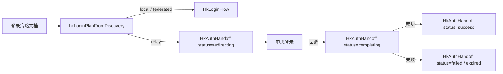

# 登录模式

Hikari 提供同一套登录流程（`HkLoginFlow`），并在它周围提供三样东西，让每个 Celestia 前端都能从服务端的登录策略文档挂载相同的登录界面：发现适配器、跳转屏幕，以及可以成为真实链接的频道行。



## 三种模式

| 模式 | 密码表单 | 提供方行 | 宿主挂载的内容 |
| --- | --- | --- | --- |
| `local` | 一个凭据频道 | `oauth` 以外的所有入口类型（目前为 `passkey`、`custom`） | 单频道的 `HkLoginFlow`，没有分段组 |
| `federated`，`password: true` | 一个凭据频道 | 表单下方是全部方法（`oauth`、`passkey`、`custom`） | 单频道的 `HkLoginFlow` |
| `federated`，`password: false` | 无 | 每个方法各自成为一个 `sso` 频道 | 每个方法一个频道的 `HkLoginFlow` |
| `relay` | 无 | 无 | **不挂载 `HkLoginFlow`**——由 `HkAuthHandoff` 跳转到中央登录 |

## 发现适配器

`loginDiscovery.ts` 是一组纯函数：没有响应式、不请求接口、不拼接 URL。类型与线上文档逐字段对应（`version`、`mode`、`password`、`methods[]`、`relay`）。

```tsx
import {
  hkLoginPlanFromDiscovery, hkRelayEntryHref,
  HkAuthHandoff, HkLoginFlow,
} from "@celestia-island/hikari/vue";

const plan = hkLoginPlanFromDiscovery(policy, {
  credentialsKey: "cloud",          // 默认 "cloud"
  credentialsLabel: "Celestia",     // 可选的分段标签
  divider: "其他方式登录",           // 可选；不传则不渲染
});
const channel = ref(plan.defaultChannel ?? "");
```

| 导出 | 结果 |
| --- | --- |
| `hkLoginPlanFromDiscovery(doc, copy?)` | `{ mode, channels, defaultChannel }`；relay 模式下 `channels` 为 `[]`、`defaultChannel` 为 `null` |
| `hkRelayEntryHref(doc, returnTo?)` | 非 relay 模式返回 `null`；否则返回入口 URL，仅当返回地址是同源路径时才追加 |
| `hkIsSameOriginPath(raw)` | `/x` 为 `true`；`//host`、`/`、相对或绝对 URL，以及含反斜杠、控制字符或改变显示的格式字符的路径为 `false`（与 kirino 对导航目标的规则相同） |

未知方法类型以及 `id` 为空的方法会被忽略——适配器绝不会因为看不懂文档而抛错。

## 跳转屏幕

`HkAuthHandoff` 是"不是表单"的登录屏幕：relay 启动页、回调交换，以及终态。它构建在 `HkAuthScreen` 之上，并沿用认证卡片的语法（logo、标题、描述）。

```tsx
<HkAuthHandoff
  status={state}                 // "redirecting" | "completing" | "success" | "failed" | "expired"
  logoSrc="/logo.svg"
  href={entryHref ?? undefined}  // redirecting：跳转目标
  delayMs={600}
  onRedirect={(href) => allow(href)}  // 返回 false 可取消
  onRetry={() => restart()}
  onBack={() => router.push("/login")}
/>
```

| 属性 | 默认值 | 效果 |
| --- | --- | --- |
| `status` | 必填 | `redirecting` / `completing`：加载指示器与礼貌的实时区域；`failed` / `expired`：`role="alert"` |
| `title` / `description` | `undefined` | 覆盖 `hikari::authHandoff.*` 中的状态文案；默认没有描述 |
| `logoSrc` | `undefined` | 不显示 logo |
| `href` | `undefined` | 传入时组件在 `delayMs` 后跳转；不传时由宿主在 `redirect` 时跳转 |
| `delayMs` | `0` | 启动页展示多久后再跳转 |
| `actions` | `failed` / `expired` 为 `["back"]`，其余为 `[]` | 内置按钮；`actions` 插槽会替换它们 |

事件：`redirect(href)`、`retry()`、`back()`。插槽：`header`、`footer`（转发给 `HkAuthScreen`）、`actions`。

## 链接行

`HkAuthChannelListEntry`——以及转发它的 `HkLoginSsoChannel`——可以带 `href`。此时该行渲染为真实的 `<a href>`：中键、Ctrl 点击可用，爬虫也能看到目标。`select(key)`（或 `sso-click`）仍会先触发，且绝不会阻止导航。禁用的链接没有 `href`，与禁用按钮一样被跳过，并带有 `aria-disabled="true"`。不传 `href` 时该行仍是 `<button type="button">`，与之前一致。

## 宿主职责

- 在服务端校验登录策略文档；hikari 信任传入的内容。
- relay 模式下不要挂载 `HkLoginFlow`——挂载 `HkAuthHandoff`。
- 只传同源路径作为返回地址；可使用 `hkIsSameOriginPath` 或你自己的白名单。
- 行的 `href` 同样必须是同源路径（文档在服务端校验）；hikari 不做检查。

## 内置中央身份提供方行的默认呈现

中央身份提供方（登录策略文档里的 `provider: "erp"`）在线上协议里没有自己的名字和图标，于是每个宿主各写各的——行里一个裸 `erp`，或者手写一个「Celestia ID」却没有图标。hikari 把这两样默认值一并提供：

- **名字** —— `hkCentralAuthName()`，或你手写的那句 `t(HK_CENTRAL_AUTH_NAME_KEY, HK_CENTRAL_AUTH_NAME_EN)`（`hikari::loginFlow.providerCelestiaAuth`，11 种语言均已提供）。优先用 `hkCentralAuthName()`：它读的是 hikari 自己的语言上下文，即使宿主的 i18n 目录没有合并 `hikari::` 键也照样是本地语言。请在渲染函数或 `computed` 里调用，不要在模块顶层取值。
- **图标** —— `hkCentralAuthMarkSrc`，一条 64×64 的内嵌 WebP data URI。按 16×16 渲染；源图自带边距，保证与周围图标视觉大小一致。

运营者的自设永远优先：部署配置里给出的 provider `label` 或 `icon` 不会被替换。只有当 label 退化为 id 时才用内置名（判断用 `hkProviderLabelIsId`），只有服务端没给 icon 时才用内置图标。没有配置该 provider 的部署毫无变化——自部署默认仍是本地账密登录。

另有一条渲染规则来自 hand-off：跳转（sso）通道本来没有第二步，所以对它传 `step="verify"` 会作为兜底渲染账号主体。宿主若从 OAuth 回调收到了二次验证因子表并传入 `verifyFactors`，该 sso 通道便会像账密通道一样渲染验证步骤——否则「仅 SSO + 启用 MFA」的部署会走死。
