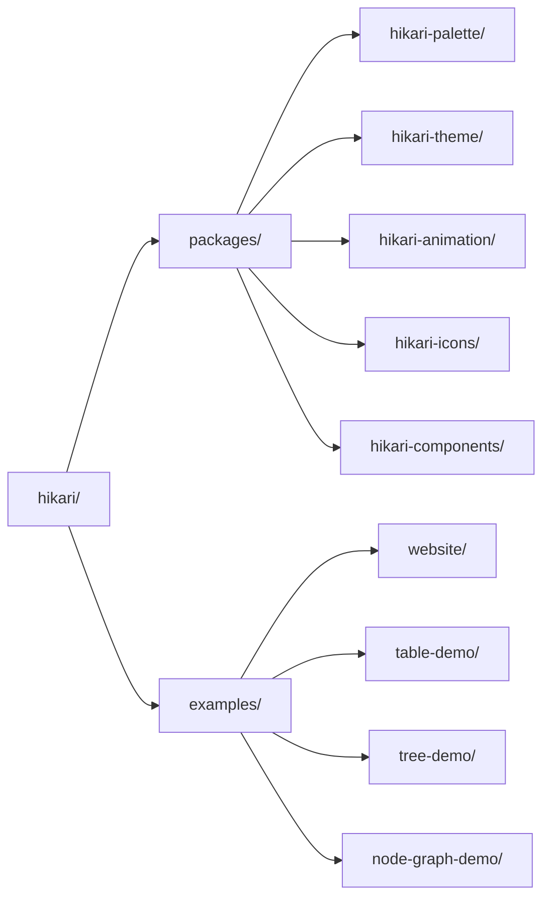

# Hikari UI 库

> 基于 Tairitsu + Grass + Axum 构建的下一代 UI 库
>
> **定位**: 一套设计系统，双运行时 —— Vue 3 与 Rust/WASM

## 什么是 Hikari？

Hikari 是一个下一代 UI 库。同一套设计系统同时交付两个一等运行时：基于 Tairitsu 框架的 Rust/WASM `hikari-*` crate，以及 Vue 3 的 `@celestia-island/hikari`。库采用模块化设计，提供完整的组件库、主题系统和动画系统；同一设计核心也在向独立应用 UI 的方向演进。

## 核心特性

### 调色板与主题
- **660+ 精选颜色**: 历史与现代色彩集合，类型安全常量
- **主题系统**: 内置浅色/深色主题及自定义预设
- **类型安全**: 编译时检查的颜色值

### 丰富的组件库
- **基础组件**: Button、Input、Card、Badge
- **反馈组件**: Alert、Toast、Tooltip、Spotlight
- **导航组件**: Menu、Tabs、Breadcrumb
- **数据组件**: Table、Tree、Pagination
- **布局组件**: Layout、Header、Aside、Content、Footer

### 强大的动画系统
- **声明式动画**: 类似 CSS 的流畅 API
- **动态值**: 运行时计算的动画值
- **缓动函数**: 30+ 种缓动函数
- **预设动画**: 淡入淡出、滑动、缩放等

### 高级特性
- **服务端渲染**: 完整的 SSR 支持
- **类型安全**: 全面利用 Rust 类型系统
- **响应式设计**: 内置响应式布局工具
- **构建系统**: 自动化的 SCSS 编译和资源生成

## 快速开始

### 安装依赖

在 `Cargo.toml` 中添加依赖：

```toml
[dependencies]
hikari-components = "0.1"
hikari-palette = "0.1"
hikari-theme = "0.1"
tairitsu = "0.5"
```

### 基础使用

```rust
use hikari_components::{ThemeProvider, Button};
use hikari_theme::ThemeProvider;

#[component]
fn App() -> Element {
    rsx! {
        ThemeProvider { initial_palette: "hikari" } {
            div { class: "hi-flex hi-flex-col hi-gap-4" {
                Button { label: "点击我" }
                Button { label: "主要按钮", variant: "primary" }
                Button { label: "次要按钮", variant: "secondary" }
            }
        }
    }
}
```

### 构建和运行

```bash
# 开发模式
cargo run

# 构建
cargo build --release

# 构建 WASM
trunk build --release
```

## 设计理念

### 一套设计系统，双运行时
- Vue 3 与 Rust/WASM 实现共享同一套组件与设计令牌
- 共享的 SCSS 核心保证两侧视觉完全一致

###  精确与清晰
- 扁平表面与清晰的信息层级
- 高对比度，确保可读性
- 克制而有目的的强调与动效

### 面向更远的场景
- Rust 侧现已支持服务端渲染
- 同一设计核心将持续演进为独立应用 UI

## 项目结构



## 文档

- [组件文档](./components/) - UI 组件使用指南
- [系统文档](./system/) - 核心系统架构说明
- [API 文档](https://docs.rs/hikari-components) - Rust API 参考

## 示例

### 主题切换

```rust
use hikari_theme::ThemeProvider;

fn App() -> Element {
    let mut theme = use_signal(|| "hikari".to_string());

    rsx! {
        ThemeProvider { initial_palette: "{theme}" } {
            button {
                onclick: move |_| {
                    theme.set(if *theme() == "hikari" {
                        "tairitsu".to_string()
                    } else {
                        "hikari".to_string()
                    });
                },
                "切换主题"
            }
        }
    }
}
```

### 使用动画

```rust
use hikari_animation::{AnimationBuilder, AnimationContext};
use hikari_animation::style::CssProperty;

// 静态动画
AnimationBuilder::new(&elements)
    .add_style("button", CssProperty::Opacity, "0.8")
    .apply_with_transition("300ms", "ease-in-out");

// 动态动画（鼠标跟随）
AnimationBuilder::new(&elements)
    .add_style_dynamic("button", CssProperty::Transform, |ctx| {
        let x = ctx.mouse_x();
        let y = ctx.mouse_y();
        format!("translate({}px, {}px)", x, y)
    })
    .apply_with_transition("150ms", "ease-out");
```

## 贡献

欢迎贡献！请阅读 [CONTRIBUTING.md](../../en/guides/CONTRIBUTING.md) 了解详情。

## 许可证

[Synthetic Source License (SySL), Version 1.0](../../../LICENSE)

## 致谢

- **Tairitsu** - 强大的 Rust UI 框架
- [Grass](https://github.com/kaj/kaj) - 纯 Rust SCSS 编译器
- [Element Plus](https://element-plus.org/) - 优秀的组件库设计参考
- [Material UI](https://mui.com/) - 现代化 UI 设计灵感

---

**Hikari** - 一套设计系统，处处一致的运行时
