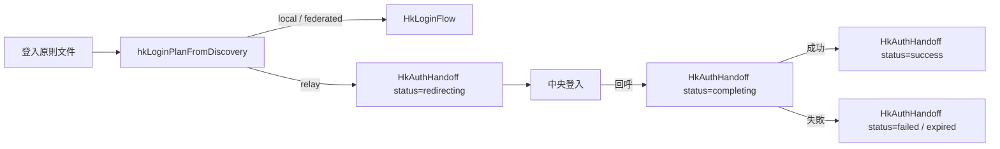

# 登入模式

Hikari 提供同一套登入流程（`HkLoginFlow`），並在它周圍提供三樣東西，讓每個 Celestia 前端都能從伺服器的登入原則文件掛載相同的登入介面：探索介面卡、交接畫面，以及可以成為真實連結的頻道列。



## 三種模式

| 模式 | 密碼表單 | 提供者列 | 宿主掛載的內容 |
| --- | --- | --- | --- |
| `local` | 一個憑證頻道 | `oauth` 以外的所有入口類型（目前為 `passkey`、`custom`） | 單一頻道的 `HkLoginFlow`，沒有分段群組 |
| `federated`，`password: true` | 一個憑證頻道 | 表單下方為全部方法（`oauth`、`passkey`、`custom`） | 單一頻道的 `HkLoginFlow` |
| `federated`，`password: false` | 無 | 每個方法各自成為一個 `sso` 頻道 | 每個方法一個頻道的 `HkLoginFlow` |
| `relay` | 無 | 無 | **不掛載 `HkLoginFlow`**——由 `HkAuthHandoff` 轉址至中央登入 |

## 探索介面卡

`loginDiscovery.ts` 是一組純函式：沒有響應式、不請求端點、不組 URL。型別與線路文件逐欄位對應（`version`、`mode`、`password`、`methods[]`、`relay`）。

```tsx
import {
  hkLoginPlanFromDiscovery, hkRelayEntryHref,
  HkAuthHandoff, HkLoginFlow,
} from "@celestia-island/hikari/vue";

const plan = hkLoginPlanFromDiscovery(policy, {
  credentialsKey: "cloud",          // 預設 "cloud"
  credentialsLabel: "Celestia",     // 選用的分段標籤
  divider: "其他方式登入",           // 選用；不傳則不轉譯
});
const channel = ref(plan.defaultChannel ?? "");
```

| 匯出 | 結果 |
| --- | --- |
| `hkLoginPlanFromDiscovery(doc, copy?)` | `{ mode, channels, defaultChannel }`；relay 模式下 `channels` 為 `[]`、`defaultChannel` 為 `null` |
| `hkRelayEntryHref(doc, returnTo?)` | 非 relay 模式回傳 `null`；否則回傳入口 URL，僅在返回位址為同源路徑時才附加 |
| `hkIsSameOriginPath(raw)` | `/x` 為 `true`；`//host`、`/`、相對或絕對 URL，以及含反斜線、控制字元或改變顯示的格式字元的路徑為 `false`（與 kirino 對導覽目標的規則相同） |

未知方法類型與 `id` 為空的方法會被忽略——介面卡絕不會因為看不懂文件而擲出錯誤。

## 交接畫面

`HkAuthHandoff` 是「不是表單」的登入畫面：relay 啟動頁、回呼交換，以及終態。它建構在 `HkAuthScreen` 之上，並沿用驗證卡片的語法（logo、標題、說明）。

```tsx
<HkAuthHandoff
  status={state}                 // "redirecting" | "completing" | "success" | "failed" | "expired"
  logoSrc="/logo.svg"
  href={entryHref ?? undefined}  // redirecting：轉址目標
  delayMs={600}
  onRedirect={(href) => allow(href)}  // 回傳 false 可取消
  onRetry={() => restart()}
  onBack={() => router.push("/login")}
/>
```

| 屬性 | 預設值 | 效果 |
| --- | --- | --- |
| `status` | 必填 | `redirecting` / `completing`：載入指示器與禮貌的即時區域；`failed` / `expired`：`role="alert"` |
| `title` / `description` | `undefined` | 覆寫 `hikari::authHandoff.*` 的狀態文案；預設沒有說明 |
| `logoSrc` | `undefined` | 不顯示 logo |
| `href` | `undefined` | 傳入時元件在 `delayMs` 後轉址；不傳時由宿主於 `redirect` 時轉址 |
| `delayMs` | `0` | 啟動頁顯示多久後再轉址 |
| `actions` | `failed` / `expired` 為 `["back"]`，其餘為 `[]` | 內建按鈕；`actions` 插槽會取代它們 |

事件：`redirect(href)`、`retry()`、`back()`。插槽：`header`、`footer`（轉發給 `HkAuthScreen`）、`actions`。

## 連結列

`HkAuthChannelListEntry`——以及轉發它的 `HkLoginSsoChannel`——可以帶 `href`。此時該列轉譯為真實的 `<a href>`：中鍵、Ctrl 點擊可用，爬蟲也看得到目標。`select(key)`（或 `sso-click`）仍會先觸發，且絕不阻止導覽。停用的連結沒有 `href`，與停用按鈕一樣被跳過，並帶有 `aria-disabled="true"`。不傳 `href` 時該列仍是 `<button type="button">`，與先前一致。

## 宿主職責

- 在伺服器端驗證登入原則文件；hikari 信任傳入的內容。
- relay 模式下不要掛載 `HkLoginFlow`——掛載 `HkAuthHandoff`。
- 只傳同源路徑作為返回位址；可使用 `hkIsSameOriginPath` 或你自己的白名單。
- 列的 `href` 同樣必須是同源路徑（文件在伺服器端驗證）；hikari 不做檢查。
